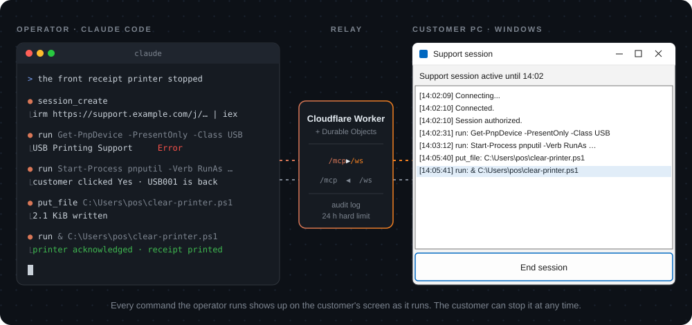
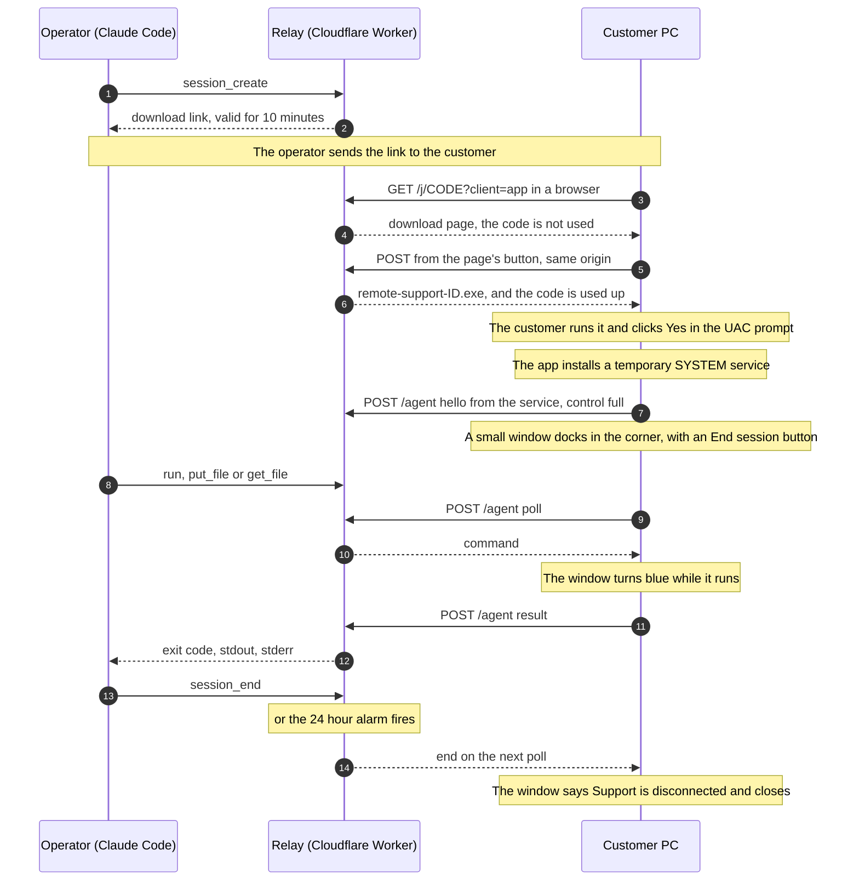
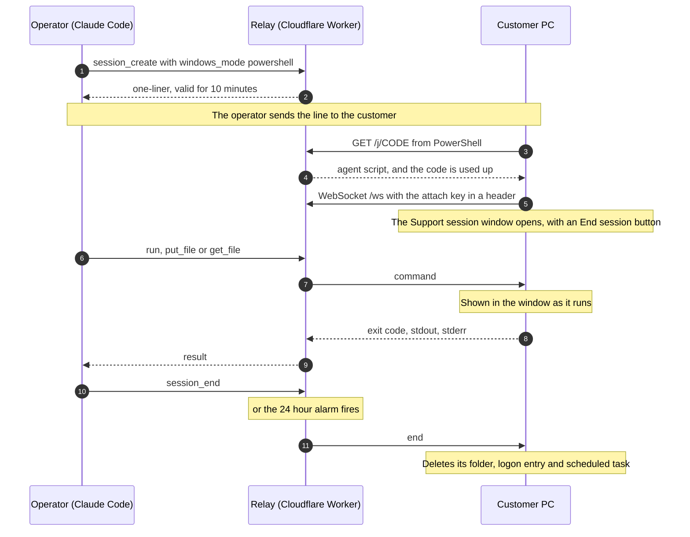
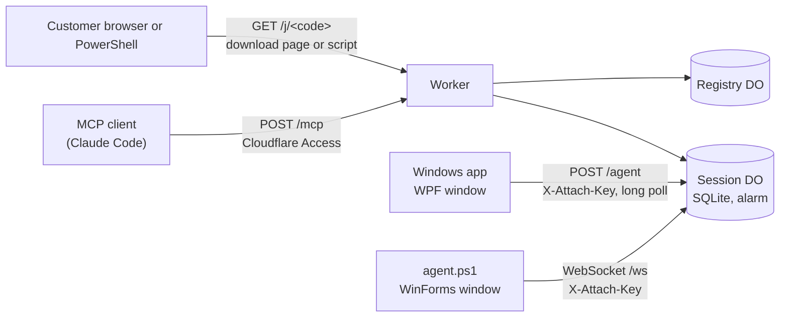

<div align="center">

# Support-MCP

**Let an AI agent fix your PC.**<br>
An MCP server on Cloudflare Workers that lets your AI agent see, control and run commands on a customer's Windows PC. It works with Claude Code, Codex, Cursor, VS Code and any other MCP client that can send custom headers over HTTP.

[](https://github.com/SUKARDADDY/Support-MCP/actions/workflows/test.yml)
[](LICENSE)
[](https://developers.cloudflare.com/durable-objects/)
[](src/agent-app.cs)
[](src/agent.ps1)
[](#mcp-tools)



[How it works](#how-it-works) · [Security](#security) · [Deploy your own](#deploy-your-own)

</div>

## Why

I'm a tech lead at a point-of-sale company. The hard cases come to me through
the support team, and talking a support agent through a fix one step at a
time often took longer than the fix.

So I built a way around the back and forth. I send the customer a link, and an
AI agent does the diagnosis and the fix while a person watches.

## At a glance

- The customer opens a link, runs the app it downloads, and clicks **Yes** when
  Windows asks for permission. That gives support full control: the app installs
  a temporary service that reaches UAC prompts, the lock screen and the sign-in
  screen, runs commands as the signed-in user or as SYSTEM, and keeps working
  after a restart.
- If the customer says No, or the PC cannot give administrator rights, the app
  offers limited support ("normal mode"): the screen, mouse and keyboard and
  commands as the signed-in user, but no Windows security prompts.
- A small window in the corner shows that the session is live.
- When the customer uses the mouse or keyboard, support's input pauses for 3
  seconds.
- Access ends 24 hours after the PC connects, or sooner if either side ends it.
- The Worker is the MCP server, so there is nothing to run on your machine.

## How it works

1. You call `session_create`. It returns a link that works once, within 10 minutes.
2. You send the link to the customer. They download the app and run it. Windows
   warns that the app is unsigned, and the download page shows them how to
   continue (see [Unsigned app](docs/security-model.md#unsigned-app)). The corner
   window says "Windows will ask for permission to give support full control.",
   and the customer clicks **Yes** in the UAC prompt.
3. The app connects to the relay. You call the screen tools (`screenshot`,
   `click`, `type_text` and the rest), `run`, `put_file` and `get_file`.
4. The session ends when you call `session_end`, the customer clicks
   **End session**, or 24 hours pass.



| Deadline | Starts at | Length |
|---|---|---|
| Link | `session_create` | 10 minutes, one use |
| First connection | the download | 2 hours |
| Session | the first connection | 24 hours. A reconnect doesn't extend it |

The app tracks the session deadline on its own clock and stops connecting once
it passes. Under full control the service stores that deadline on disk and
removes itself when it passes, even if the PC was off at the time.

### Full control and the fallback

Full control is the default. When the customer runs the app, the corner window
says "Windows will ask for permission to give support full control.", and
Windows shows its UAC prompt. On **Yes** the app installs, for this session only:

- the folder `%ProgramFiles%\SupportMCP-<first 8 characters of the session id>\`,
  readable only by SYSTEM and Administrators, with a copy of the app, its
  session settings and the deadline;
- the service `SupportMcp-<id>` ("Remote support session"), automatic start,
  running as LocalSystem;
- a scheduled task of the same name at the deadline, as a backstop;
- the registry value `SoftwareSASGeneration`, only when Windows would refuse
  Ctrl+Alt+Del from a service, and a record of it under
  `HKLM\SOFTWARE\SupportMCP`. The last session to end puts the old value, or
  its absence, back, unless an administrator changed it meanwhile.

If no UAC prompt will appear (the app already runs as administrator, UAC is off,
or an administrator elevates without a prompt), the app asks itself first: "Give
support full control of this PC?". If the customer says No, or anything fails,
the app asks "Continue with limited support?" with **Don't allow** selected.
**Allow** gives normal mode, **Don't allow** ends the app with nothing installed.
From normal mode, `request_full_control` asks again.

Everything is removed when the session ends: by `session_end`, by **End
session**, by the relay's 24-hour alarm, or by the service's own clock. If the
service was killed, the backstop task removes the service, the registry value,
the folder and itself at the deadline, without running the app. A restart or
a sign-out does not end the session, and does not extend it.

### The PowerShell alternative

Call `session_create` with `windows_mode: "powershell"` to get a one-liner for
Windows 8 and later, with nothing to download:

```powershell
irm https://support.example.com/j/zp5z7xuckhrm6s7t | iex
```

The customer pastes it. The script copies itself to
`%LOCALAPPDATA%\SupportMCP\<id>\`, opens a window titled "Support session",
and connects back over a WebSocket. Unlike the app, that window lists every
command and file operation as it runs, above an **End session** button. It also
registers a logon entry and a scheduled task so it can clean up after a reboot
or a killed process.



For the PowerShell path, only a request from PowerShell uses the code up. A chat
app that previews the link gets a short harmless message instead. The agent
keeps the same two-hour first-connection limit on its own clock (`connect_by`
in its config), so a PC that never connects cleans up even if the relay is
gone.

### Windows modes

`session_create` takes `windows_mode`. `session_status` reports the same
canonical name.

| Value | Customer does | Works on |
|---|---|---|
| `app` (default) | opens a link, downloads and runs the app, clicks Yes in the UAC prompt (or Allow for limited support) | Windows 7 to 11 (7 and 8.1 need .NET Framework 4.5.2 or later; the app asks for TLS 1.2 itself, so Windows 7 needs no registry change) |
| `powershell` | pastes one line | Windows 8 and later |

The PowerShell mode is the fallback: it runs commands and moves files, and it
has no screen access. Use it only when the app cannot run. Any other value is
an error.

## MCP tools

| Tool | Does |
|---|---|
| `session_create` | `windows_mode` `app` (default) returns `{session_id, windows_mode, download_url, one_liner, code_expires_at}`; `powershell` returns `{session_id, windows_mode, one_liner, code_expires_at}` |
| `session_list` | every session with its state, expiry and machine |
| `session_status` | state, `windows_mode`, machine, user, expiry, `startup_expires_at` while waiting, whether the client is attached, `client_version`, last audit rows. App sessions add `elevated`, `control` (`full`, `normal` or `null`), `caps`, and when the app reports them `desktop`, `paused_until` and `input_blocked_until` |
| `run` | runs PowerShell on the customer's PC. `as` is `user` (default) or `system`. Under full control `user` is the signed-in console user, with administrator rights when that user has them, and fails with `nobody is signed in; use as: "system"` at the sign-in screen; `system` is SYSTEM. In normal mode the relay refuses `system`. Returns exit code, stdout, stderr, timed_out |
| `put_file` | writes base64 data to a path, with append for chunking. As SYSTEM under full control |
| `get_file` | reads a byte range as base64, with `eof` for chunking. As SYSTEM under full control |
| `session_end` | tells the client to stop and marks the session ended |
| `screenshot`, `click`, `move_mouse`, `drag`, `scroll`, `type_text`, `press_key`, `wait`, `zoom` | the screen, mouse and keyboard, one tool per action. A screenshot comes back as an image, then the size, display and desktop (`default`, or `secure` for UAC, the lock and sign-in screens and Ctrl+Alt+Del) as JSON. Every input takes `screenshot:false` to skip the screenshot that follows it. An input that switched the desktop and left no screenshot still succeeds, with the note "input sent; no screenshot". `press_key` refuses Win+L, which Windows ignores: lock with `run` as `user` and `rundll32.exe user32.dll,LockWorkStation` |
| `ui_tree`, `ui_act` | a fallback for when a screenshot and zoom are not enough: read a window's controls and act on one by its ref, through UI Automation. Each `ui_tree` line ends with the verbs `ui_act` can use on that control (`[12] Button "OK" (640,412) invoke,focus`); a verb the control does not support is refused, so click its coordinates instead. Agents do better working from screenshots, zoom for small text and Ctrl+F in the app for text on a long page |
| `block_input` | lock the customer's mouse and keyboard for up to 10 minutes; it lifts by itself, and Ctrl+Alt+Del lifts it at once. Full control only |
| `send_sas` | send Ctrl+Alt+Del. Full control only |
| `type_secret` | type a secret the operator supplied in the conversation into the focused field, such as the Windows password on the sign-in screen. At that screen the model types the password with this tool if the operator gave it one, and stops and asks if not. It works in normal mode too. It is never logged or returned, and a failure says only `type_secret failed` |
| `request_full_control` | from normal mode, ask the customer for full control through a UAC prompt. On Yes the session continues under full control |

Add `?ui=0` to the MCP URL to hide `ui_tree` and `ui_act`; any other value is a
400 error. The old `?shape=` parameter is gone: the server offers only the tools
above, and a request that still sends `shape` gets a 400 error. Every tool except
`session_create` and `session_list` needs a `session_id`; a call without one
fails with `session_id is required; call session_list to find it`, and the relay
never picks a session for you. `run`, `put_file` and `get_file` use their own
lane, so a long command does not block the screen.

## Architecture



| Path | Auth | Purpose |
|---|---|---|
| `GET /healthz` | public | liveness |
| `GET /j/<code>?client=app` | public, https only | the download page. Never uses the code up |
| `POST /j/<code>?client=app` | public, single use, https only, same origin | returns the session's executable and uses the code up |
| `GET /j/<code>` | public, single use, https only | serves the PowerShell agent script with the session values filled in, to PowerShell clients only |
| `POST /agent?sid=` | attach key in a header, https only | the app's transport: hello, long poll, results and end, as JSON |
| `GET /ws?sid=` | attach key in a header, https only | PowerShell agent WebSocket, using the hibernation API |
| `POST /mcp` | Cloudflare Access | MCP JSON-RPC 2.0, stateless HTTP |

The Worker itself is the MCP server. There is no local bridge process. Each
session is one Durable Object holding its state machine, its audit log and an
alarm for expiry. A second Durable Object keeps the list for `session_list`.

| Source file | What it does |
|---|---|
| `src/app.js` | router, Access JWT gate, MCP handler, download page |
| `src/session.js` | `Session` Durable Object: states, audit log, alarm, tagged sockets, the app's polling transport |
| `src/registry.js` | `Registry` Durable Object for `session_list` |
| `src/mcp.js` | JSON-RPC dispatch, the tool schemas, and the mapping of each screen tool to one normalized action |
| `src/screen.js` | the screen actions, their audit text, and the strict check of every field an app result may carry |
| `src/jwt.js` | RS256 verification of the Access JWT with WebCrypto |
| `src/template.js` | builds the served script and the downloaded executable, validates every value placed in them, and maps the mode aliases |
| `src/agent-app.cs` | the Windows app: C# source for .NET Framework 4.5.2 or later. One exe with several roles: the customer's app (WPF window, dialogs, HTTPS polling client with two lanes, normal-mode screen control), `--elevate-install`, the full-control `--service`, the SYSTEM `--helper` that runs screen operations on the console session, and the `--window` corner window |
| `src/agent-app.manifest` | the app's `asInvoker` manifest. The app asks for elevation only through `--elevate-install`, after the customer started it |
| `src/app-bundle.json` | the compiled x86 app with the SHA-256 of its source and manifest. Tests fail when the source changed without a rebuild |
| `src/agent.ps1` | the PowerShell agent: bootstrap, run and cleanup roles in one file |
| `scripts/build-app.ps1` | builds `src/app-bundle.json` on Windows with the built-in compiler, against the 4.5.2 reference assemblies (`-ReferenceDir`, required). `-OutDir <folder>` writes only the exe and leaves the bundle alone |
| `scripts/fetch-net452-refs.ps1` | downloads the pinned 4.5.2 reference assemblies from nuget.org, verifies their SHA-512, and prints the folder to pass as `-ReferenceDir` |
| `scripts/app-references.ps1` | the compiler arguments shared by the build and the native tests |
| `scripts/test-app-native.ps1` | compiles and runs `test/app-native.cs` against the app source on Windows, with the same references |
| `scripts/normalize-pe.mjs` | zeroes the build-specific fields of a .NET exe so two builds of one source compare equal |
| `scripts/verify-app-binary.mjs` | compares a fresh build with the exe in `src/app-bundle.json` after normalizing both |
| `scripts/prepare-app-restart.ps1` | optional: one automatic reconnect after a restart the customer authorized |
| `test/app-native.cs` | native tests for the app, compiled and run on Windows by `scripts/test-app-native.ps1` and by CI |

## Security

The full design is in [docs/security-model.md](docs/security-model.md). Before
you use it:

- Use it only on a computer whose owner asked for support and agreed to the
  session. You are responsible for following the law where you and the
  customer are.
- Tell the customer who you are before you send the link. The app is unsigned,
  and anyone can ask a customer to run an unsigned program.
- Screenshots, and the text you type, go to your AI model provider. Don't open
  a session on a screen you may not share with it.
- Treat everything that comes back from a session as untrusted. Output, file
  contents, screenshots, window text and the machine name are all written by the
  customer's PC, and they can try to steer your AI agent. Your agent may have a shell on your own
  machine, so don't auto-approve its tool calls.
- The window shows that access exists. It doesn't limit what you can do. Under
  full control you have SYSTEM rights, and what you change stays changed after
  the session ends.
- The UAC prompt, the app's dialogs, the window and the **End session** button
  are how the customer agrees to the session and stops it. Keep them in any
  fork.

## Deploy your own

You need a Cloudflare account with a zone for the hostname, Node 22 and
`wrangler`. The repository includes a built `src/app-bundle.json`, so you can
deploy without Windows. You need Windows only to change the app: see
[Build the app](docs/development.md#build-the-app).

1. **Create the Access guard for `/mcp`.** This makes a service token for the
   MCP client and an Access app with two policies, your email and the token.
   ```sh
   CLOUDFLARE_API_TOKEN=... CLOUDFLARE_ACCOUNT_ID=... \
   SUPPORT_HOST=support.example.com SUPPORT_OPERATOR_EMAIL=you@example.com \
   cf/access-setup.sh
   ```
   The API token needs Access: Apps and Policies (Edit) and Access: Service
   Tokens (Edit). The script writes the client secret to
   `~/.config/support-mcp/access.env` with mode 600, never prints it, and
   prints the app's AUD tag at the end. The service token lasts one year.
   Running the script again does not replace it, so rotate it in the Zero Trust
   dashboard and update `access.env`.
2. **Fill in `wrangler.toml`.** Set the route hostname, `ACCESS_TEAM_DOMAIN`
   and `ACCESS_AUD`, then run `npx wrangler deploy`.
3. **Harden the zone.** Turn on **Always Use HTTPS** for the zone (SSL/TLS,
   Edge Certificates), so a link pasted without `https://` is redirected. The
   relay refuses `/j` and `/ws` over plain http either way. The relay does no
   rate limiting of its own, so add a Cloudflare rate-limiting rule on `/j` and
   `/ws`.
4. **Connect your MCP client.** Every request to `/mcp` needs the headers
   `CF-Access-Client-Id` and `CF-Access-Client-Secret`. `cf/mcp-headers.sh`
   reads them from `~/.config/support-mcp/access.env` when the client connects,
   so the secret stays out of the client's config file.

   Claude Code:
   ```sh
   claude mcp add-json -s user support-mcp \
     '{"type":"http","url":"https://support.example.com/mcp","headersHelper":"/path/to/Support-MCP/cf/mcp-headers.sh"}'
   ```

   Codex, in `~/.codex/config.toml`. `tool_timeout_sec` has to be above 600
   seconds, the longest `run` timeout:
   ```toml
   [mcp_servers.support-mcp]
   url = "https://support.example.com/mcp"
   http_headers_helper = "/path/to/Support-MCP/cf/mcp-headers.sh"
   tool_timeout_sec = 630
   ```

   Other clients need the same two headers. If a client can't run a helper,
   put the values in its config, and keep that file out of git.

## Develop

```sh
node --test    # unit and route tests, no network
```

Building the Windows app, running a local dev server, and what the tests and CI
check are in [docs/development.md](docs/development.md).

## Limits

- Windows only. The app needs .NET Framework 4.5.2 or later and working TLS 1.2
  with the normal Windows certificate checks, and runs on Windows 7 to 11.
  Windows 10 and 11 include both. Windows 8.1 ships .NET 4.5.1 and needs the
  4.5.2 update. Windows 7 ships only .NET 3.5.1, so it needs .NET Framework
  4.5.2 or later installed first. The app turns TLS 1.2 on for its own
  connections, so Windows 7 needs no TLS registry change. Tested on Windows 7
  SP1 (32-bit) with stock .NET Framework 4.5.2 (Release 379893) and no TLS
  registry changes, against the live relay: the app attaches, runs commands and
  moves files. That test predates screen control and full control, which were
  tested on Windows 11 only. The PowerShell agent targets Windows PowerShell 5.1, which ships
  with Windows 10 and 11.
- Nothing is signed. The app shows a SmartScreen warning (see
  [Unsigned app](docs/security-model.md#unsigned-app)). `irm | iex` content has no Mark of the Web, so
  SmartScreen doesn't apply to the PowerShell agent, but Defender heuristics
  could still flag either on some machines.
- The app runs one command and one screen operation at a time. A second
  `run`, `put_file` or `get_file` while one is waiting returns `agent busy`, and
  so does a second screen call. Its output is capped at 64 KiB per stream, and
  its file chunks match the PowerShell agent's.
- Full control works on the console session only, not in Remote Desktop
  sessions. It follows the console through sign-out, sign-in, lock and a user
  switch. Before anyone signs in there is no corner window.
- The app is unsigned, and it installs a service. Antivirus may remove or block
  it, which is why the download page says "If your antivirus removes the file,
  tell support." The backstop task does not depend on the app's file.
- Normal mode works in the customer's own desktop session only. It cannot see or
  control UAC prompts, the lock screen or the sign-in screen (the result reports
  `desktop: unknown` and input fails), and it refuses to click or type into a
  window that runs as administrator. Under full control that limit (UIPI) no
  longer applies. Both modes refuse clicks on the app's own windows, and keys,
  typed text and `ui_tree` while one of them has the keyboard focus. The corner
  window does not take the focus when it appears; only asking to end activates
  it, and Keep connected gives the focus back to the window that had it. Input
  also fails for 3 seconds after the customer last used the mouse or keyboard,
  keyboard, except while `block_input` holds it.
- Commands run in the 32-bit Windows PowerShell, because the app is x86. On
  64-bit Windows, use `C:\Windows\Sysnative\...` to reach 64-bit tools such
  as `logoff.exe`, and `reg.exe /reg:64` for the 64-bit registry view.
- Typing is paced at one character every 20 ms, because Windows 11 Notepad
  garbles faster input. A 5000-character `type` takes about 100 seconds.
- The app polls over HTTPS, so a command's result reaches the operator after
  the next poll round trip. A screenshot is at most 700,000 base64 characters
  (about 500 KB), so the app lowers the JPEG quality until it fits.
- An old app from before screen control keeps working for commands and files.
  Its screen calls return `this support app is too old for screen control`. The
  PowerShell fallback has no screen access either.
- It is built for one operator, or a few people sharing one Access app. There
  are no per-operator permissions.
- Command output is capped at 262,144 characters per stream, and the whole
  result frame is trimmed to fit the WebSocket message limit. Files move in
  chunks of about 512 KiB.
- If a command leaves a background process running that keeps its output open,
  the agent waits about 5 seconds after the command exits and stops that
  process if it can find it. Output on a stream that process still holds open
  is discarded, and the result is marked with an `[output incomplete]` note. A
  process started with `Start-Process -NoNewWindow` and no `-Wait` is stopped
  about 5 seconds after the command returns, so use `-Wait`, or plain
  `Start-Process` (which does not share the output pipe), for programs that
  must keep running.
- If Task Scheduler is unavailable, no fallback cleanup task exists, whether
  the agent has connected or not. An agent that is killed is then cleaned up
  the next time it starts after its deadline, normally at logon.
- Where an administrator has turned on PowerShell script block logging, Windows
  may record the served script, including the attach key, in the PowerShell
  Operational event log. The key stays valid for the life of the session.

## Contributing

Only collaborators can open pull requests here. To suggest a change or report
a bug, open an issue. To report a vulnerability, see [SECURITY.md](SECURITY.md).

## License

[MIT](LICENSE).
