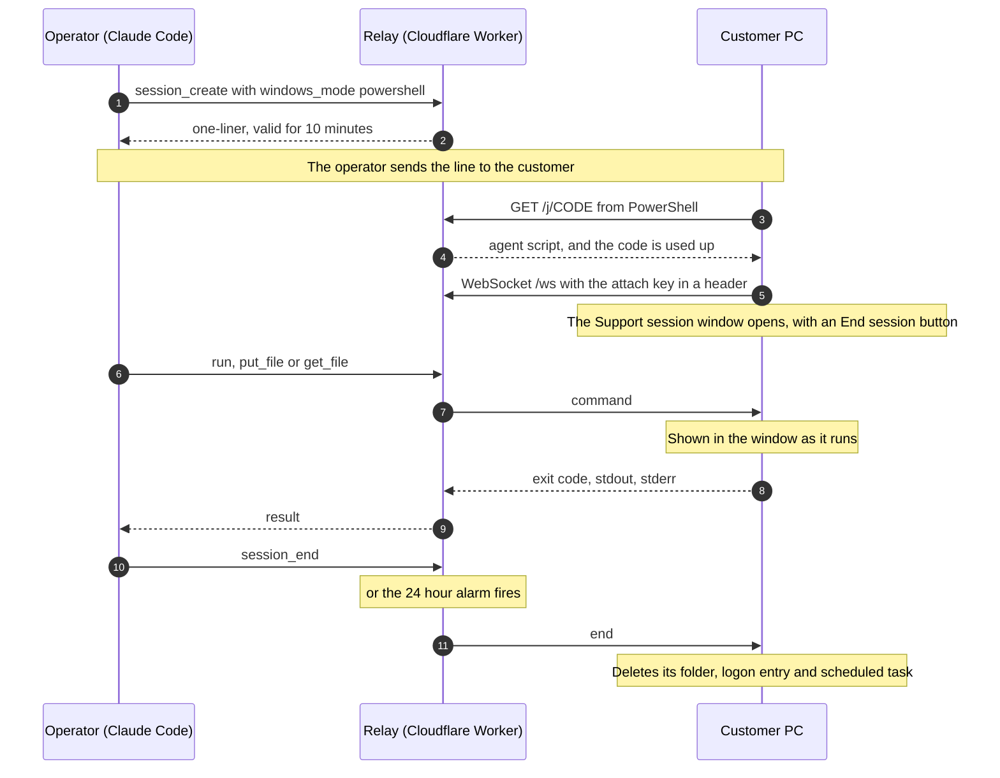
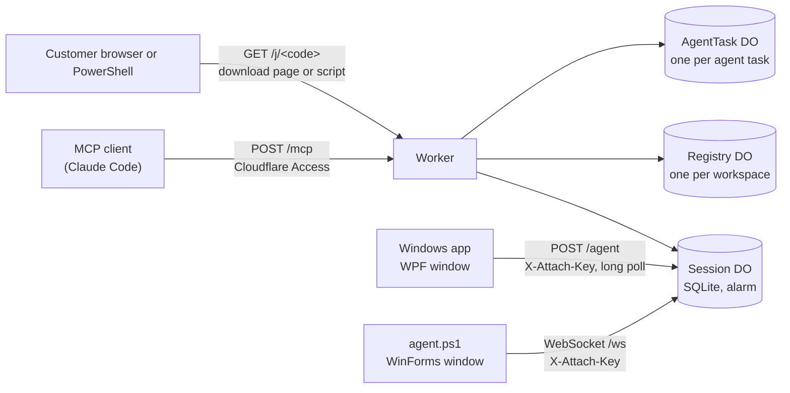

<div align="center">

# Support-MCP

**Let an AI agent fix your PC.**<br>
An MCP server on Cloudflare Workers that lets your AI agent see, control and run commands on a customer's Windows PC. It works with Claude Code, Codex, Cursor, VS Code and any other MCP client that can send custom headers over HTTP.

[](https://github.com/SUKARDADDY/Support-MCP/actions/workflows/test.yml)
[](LICENSE)
[](https://developers.cloudflare.com/durable-objects/)
[](src/agent-app.cs)
[](src/agent.ps1)
[](#mcp-tools)


[How it works](#how-it-works) · [Security](#security) · [Deploy your own](#deploy-your-own)

</div>

## Why

I'm a tech lead at a point-of-sale company. The hard cases come to me through
the support team, and talking a support agent through a fix one step at a
time often took longer than the fix.

So I built a way around the back and forth. I send the customer a link, and an
AI agent does the diagnosis and the fix while a person watches.

## At a glance

- The customer opens a link, runs the app it downloads, clicks **Allow** when it
  asks "Give support full control of this PC?", and **Yes** when Windows asks for
  permission. That gives support full control: the app installs
  a temporary service that reaches UAC prompts, the lock screen and the sign-in
  screen, runs commands as the signed-in user or as SYSTEM, and keeps working
  after a restart.
- If the customer says No, or the PC cannot give administrator rights, the app
  offers limited support ("normal mode"): the screen, mouse and keyboard and
  commands as the signed-in user, but no Windows security prompts.
- A small window in the corner shows that the session is live.
- A PC's owner can also install the app permanently as a saved PC, so the
  support team keeps it on their list and its agent can connect to it with one
  tool call (`device_connect`). The PC asks the person at it first when it is set
  to ask, one technician drives at a time, and a workspace or the whole relay can
  be stopped at once. A saved PC updates itself, but only to a release signed with
  the project's offline release key. See [Saved devices](#saved-devices).
- When the customer uses the mouse or keyboard, support's input pauses for 3
  seconds.
- Access ends 24 hours after the PC connects, or sooner if either side ends it.
- The Worker is the MCP server, so there is nothing to run on your machine.
- A support team can share one relay. Each tool call is checked against the
  caller's role, so a Viewer can watch but not act.
- MCP clients (Claude Code, Codex, Cursor, VS Code) can sign in as a person
  through the relay's own OAuth, or keep using an Access service token. Service
  tokens work on the MCP addresses either way.

## How it works

1. You call `session_create`. It returns a link that works once, within 10 minutes.
2. You send the link to the customer. They download the app and run it. Windows
   warns that the app is unsigned, and the download page shows them how to
   continue (see [Unsigned app](docs/security-model.md#unsigned-app)). The app
   asks "Give support full control of this PC?", the customer clicks **Allow**,
   and then **Yes** in the UAC prompt.
3. The app connects to the relay. You call the screen tools (`screenshot`,
   `click`, `type_text` and the rest), `run`, `put_file` and `get_file`.
4. The session ends when you call `session_end`, the customer clicks
   **End session**, or 24 hours pass.


| Deadline | Starts at | Length |
|---|---|---|
| Link | `session_create` | 10 minutes, one use |
| First connection | the download | 2 hours |
| Session | the first connection | 24 hours. A reconnect doesn't extend it |

The app tracks the session deadline on its own clock and stops connecting once
it passes. Under full control the service stores that deadline on disk and
removes itself when it passes, even if the PC was off at the time.

### Full control and the fallback

Full control is the default. When the customer runs the app, it asks "Give
support full control of this PC?". On **Allow** the question stays open and says
"Windows will ask for permission to give support full control.", and Windows
shows its UAC prompt. Windows brings that prompt to the front only for an app
in the foreground, and the click on **Allow** puts the app there; otherwise the
prompt would wait as a flashing taskbar button. On **Yes** the app installs,
for this session only:

- the folder `%ProgramFiles%\SupportMCP-<first 8 characters of the session id>\`,
  readable only by SYSTEM and Administrators, with a copy of the app, its
  session settings and the deadline;
- the service `SupportMcp-<id>` ("Remote support session"), automatic start,
  running as LocalSystem;
- a scheduled task of the same name at the deadline, as a backstop;
- the registry value `SoftwareSASGeneration`, only when Windows would refuse
  Ctrl+Alt+Del from a service, and a record of it under
  `HKLM\SOFTWARE\SupportMCP`. The last session to end puts the old value, or
  its absence, back, unless an administrator changed it meanwhile.

If no UAC prompt will appear (the app already runs as administrator, UAC is off,
or an administrator elevates without a prompt), the same question is the
consent, and Allow installs at once. If the customer says No, or anything fails,
the app asks "Continue with limited support?" with **Don't allow** selected.
**Allow** gives normal mode, **Don't allow** ends the app with nothing installed.
From normal mode, `request_full_control` asks again.

Everything is removed when the session ends: by `session_end`, by **End
session**, by the relay's 24-hour alarm, or by the service's own clock. If the
service was killed, the backstop task removes the service, the registry value,
the folder and itself at the deadline, without running the app. A restart or
a sign-out does not end the session, and does not extend it.

### The PowerShell alternative

Call `session_create` with `windows_mode: "powershell"` to get a one-liner for
Windows 8 and later, with nothing to download:

```powershell
irm https://support.example.com/j/zp5z7xuckhrm6s7t | iex
```

The customer pastes it. The script copies itself to
`%LOCALAPPDATA%\SupportMCP\<id>\`, opens a window titled "Support session",
and connects back over a WebSocket. Unlike the app, that window lists every
command and file operation as it runs, above an **End session** button. It also
registers a logon entry and a scheduled task so it can clean up after a reboot
or a killed process.



For the PowerShell path, only a request from PowerShell uses the code up. A chat
app that previews the link gets a short harmless message instead. The agent
keeps the same two-hour first-connection limit on its own clock (`connect_by`
in its config), so a PC that never connects cleans up even if the relay is
gone.

### Windows modes

`session_create` takes `windows_mode`. `session_status` reports the same
canonical name.

| Value | Customer does | Works on |
|---|---|---|
| `app` (default) | opens a link, downloads and runs the app, clicks Allow and then Yes in the UAC prompt (or Allow for limited support) | Windows 7 to 11 (7 and 8.1 need .NET Framework 4.5.2 or later; the app asks for TLS 1.2 itself, so Windows 7 needs no registry change) |
| `powershell` | pastes one line | Windows 8 and later |

The PowerShell mode is the fallback: it runs commands and moves files, and it
has no screen access. Use it only when the app cannot run. Any other value is
an error.

## MCP tools

| Tool | Does |
|---|---|
| `session_create` | `windows_mode` `app` (default) returns `{session_id, windows_mode, download_url, one_liner, code_expires_at}`; `powershell` returns `{session_id, windows_mode, one_liner, code_expires_at}` |
| `session_list` | every session with its state, expiry and machine |
| `session_status` | state, `windows_mode`, machine, user, expiry, `startup_expires_at` while waiting, whether the client is attached, `client_version`, `client_agent`, last audit rows. App sessions add `elevated`, `control` (`full`, `normal` or `null`), `caps`, and when the app reports them `desktop`, `paused_until` and `input_blocked_until` |
| `run` | runs PowerShell on the customer's PC. `as` is `user` (default) or `system`. Under full control `user` is the signed-in console user, with administrator rights when that user has them, and fails with `nobody is signed in; use as: "system"` at the sign-in screen; `system` is SYSTEM. In normal mode the relay refuses `system`. Returns exit code, stdout, stderr, timed_out |
| `put_file` | writes base64 data to a path, with append for chunking. As SYSTEM under full control |
| `get_file` | reads a byte range as base64, with `eof` for chunking. As SYSTEM under full control |
| `session_end` | tells the client to stop and marks the session ended |
| `device_list` | the team's saved PCs with their fields and `online` (true while the PC's doorbell is connected). Needs `devices.view`. Names and custom field values are untrusted text |
| `device_connect` | connect to a saved PC by its id: `{device_id, ask?, take_over?}`. Returns `{session_id, state: "waiting", asks, rang}`; poll `session_status` until it is attached, then use the session tools. The PC asks its person first when it is set to ask, when you pass `ask: true`, or when your role may not connect without asking. `take_over: true` takes the driving seat of a session another technician started |
| `agent_start` | hand a task to the relay's [built-in agent](#built-in-agent): `{device_id \| session_id, instructions, keep_working?, model?}`. Returns `{task_id, state, model, ...}`. Needs `sessions.control`, and a team that allows the built-in agent |
| `agent_status` | follow a task: `{task_id, wait_s?}` returns its state, cost, the tool calls it made, its notes and its summary. With no `task_id` it lists recent tasks and the models the team can use, with prices. Needs `sessions.view`. Notes and summaries are untrusted text |
| `agent_control` | `{task_id, action}` with `pause`, `resume` or `stop`. Needs `sessions.control` |
| `screenshot`, `click`, `move_mouse`, `drag`, `scroll`, `type_text`, `press_key`, `wait`, `zoom` | the screen, mouse and keyboard, one tool per action. A screenshot comes back as an image, then the size, display and desktop (`default`, or `secure` for UAC, the lock and sign-in screens and Ctrl+Alt+Del) as JSON. Every input takes `screenshot:false` to skip the screenshot that follows it. An input that switched the desktop and left no screenshot still succeeds, with the note "input sent; no screenshot". `press_key` refuses Win+L, which Windows ignores: lock with `run` as `user` and `rundll32.exe user32.dll,LockWorkStation` |
| `ui_tree`, `ui_act` | a fallback for when a screenshot and zoom are not enough: read a window's controls and act on one by its ref, through UI Automation. Each `ui_tree` line ends with the verbs `ui_act` can use on that control (`[12] Button "OK" (640,412) invoke,focus`), or with `disabled` for a greyed-out control; a verb the control does not support is refused, so click its coordinates instead. Agents do better working from screenshots, zoom for small text and Ctrl+F in the app for text on a long page |
| `block_input` | lock the customer's mouse and keyboard for up to 10 minutes; it lifts by itself, and Ctrl+Alt+Del lifts it at once. Full control only |
| `send_sas` | send Ctrl+Alt+Del. Full control only |
| `type_secret` | type a secret the operator supplied in the conversation into the focused field, such as the Windows password on the sign-in screen. At that screen the model types the password with this tool if the operator gave it one, and stops and asks if not. It works in normal mode too. It is never logged or returned, and a failure says only `type_secret failed` |
| `request_full_control` | from normal mode, ask the customer for full control: the app shows the same question, then Windows its UAC prompt. On Allow and Yes the session continues under full control |

Add `?ui=0` to the MCP URL to hide `ui_tree` and `ui_act`; any other value is a
400 error. The old `?shape=` parameter is gone: the server offers only the tools
above, and a request that still sends `shape` gets a 400 error. Every tool except
`session_create`, `session_list`, `device_list`, `device_connect` and the three agent tools needs a `session_id`; a call without one
fails with `session_id is required; call session_list to find it`, and the relay
never picks a session for you. `run`, `put_file` and `get_file` use their own
lane, so a long command does not block the screen.

## Teams

The relay holds one or more workspaces, and each has its own members, roles,
team log and sessions. The `default` workspace always exists. Until you add its
first member, it works as before: anyone Cloudflare Access lets in can use every
tool. Once it has a member, only members can use the MCP endpoint, and each tool
call is checked against the caller's role before it reaches a session. Until
then, nobody can change the team except by adding themselves as the first admin:
an attempt to edit or add a role, or to change or remove a member, gets a 409
`first_member`. This open mode is `default`'s alone.

- **More workspaces.** A deployment admin creates one with
  `POST /api/v1/w` and a body of `{"slug":"acme","name":"Acme Support"}`. The
  slug is 1 to 40 characters of `a-z`, `0-9` and `-`, and `default` is
  reserved. The caller becomes its admin in the same step, so a workspace never
  exists without one and is never open. With `DEPLOYMENT_ADMINS` empty,
  creation is refused with a 409 `no_deployment_admins`. An identity not listed
  there gets a 403 `forbidden`, and a slug already taken gets a 409
  `workspace_exists`. `GET /api/v1/w` lists the workspaces you belong to as
  `{slug, name, role_id}`, and `default` while it is open (with `role_id`
  `null`) or when you are a member of it.
- **Where a workspace lives.** Its MCP address is `/w/<slug>/mcp` (`/mcp` is
  `default`) and its team API is `/api/v1/w/<slug>/...`. A slug that was never
  created is a 404 on the API and a tool error, `workspace not found`, on its
  MCP address. `tools/list` still answers without looking anything up. Each
  workspace has its own session list, and a session answers an operator call
  from another workspace as if it did not exist. `/w/default/mcp` is a 404:
  `default` has one address.
- **Members** are identities from Cloudflare Access: a person by email, or an
  MCP client signed in with a service token by the token's client ID (the
  `CF_ACCESS_CLIENT_ID` value, which ends in `.access`). Identities ignore case
  and surrounding spaces.
- **Roles.** `admin` can do everything and can't be changed. `technician` can
  create, view, control and end sessions, and view and manage customers, sites
  and saved PCs. `viewer` can view sessions, read the team log and view customers,
  sites and saved PCs. Admins can edit `technician` and `viewer`, delete them
  while no member holds them, and add roles of their own from these permissions:
  `members.manage`, `roles.manage`, `audit.view`, `devices.view`,
  `devices.manage`, `fields.manage`, `sessions.create`, `sessions.view`,
  `sessions.control`, `sessions.end`, `sessions.unattended`. Only `admin` holds
  `sessions.unattended` ("connect to a PC without asking the person at it, and
  switch a PC to any time") by default, and open mode never grants it. A workspace that edited `technician` or
  `viewer` before the device permissions existed keeps its edit, without them
  (admins hold every permission). Because `technician` and `viewer` now hold
  more, a custom role with `members.manage` but no device permissions can no
  longer add or change people in those roles, under the rule below.
- **Who can give what.** Having `members.manage` or `roles.manage` does not let
  a member reach admin. Only an admin can add a member as admin, move anyone to
  or from admin, or remove an admin. Everyone else can give a member only a role
  whose permissions they hold themselves, and can create or edit a role only so
  that it holds permissions they hold. Everyone else can also rename, demote or
  remove only a member whose role holds nothing they lack, so a member manager
  can't touch an admin or anyone stronger than themselves. They can also edit
  (a rename counts) or delete only a role whose current permissions they hold,
  so a role manager can't narrow or delete a stronger role. Nobody can change
  their own role or edit or delete the role they hold. An admin can demote
  themselves only while another admin remains. A refused change is a 403 with
  the code `forbidden` and a plain reason. A member whose role no longer exists
  can be given a role that does, and an admin can remove them. Any other change
  to them is a 409 `role_missing`.
- **Which tool needs what.** `session_create` needs `sessions.create`,
  `session_list` and `session_status` need `sessions.view`, `session_end` needs
  `sessions.end`, `device_list` needs `devices.view`, and every other tool needs
  `sessions.control` (`device_connect` also needs `sessions.unattended` to connect
  without asking or to take over). Controlling a
  full-control session is administrator-level on the customer's PC, so give
  `sessions.control` only to people you would trust with that.
- **A refused call** is a tool error: `you are not a member of this team`, or
  `your role does not allow sessions.control`. Removing a member takes effect on
  their next call.
- **The first member of `default` must be you, as admin.** If `DEPLOYMENT_ADMINS` is set,
  you must be listed in it. Add your MCP client's service token as a member at
  the same time, or it loses access. While the team has no members,
  `GET /api/v1/w/default` lists who has been calling, service tokens included.
- **The team log** records every change to members and roles. Each entry seals
  the one before it, so an edit, removal or reordering of an entry shows, unless
  it is among the newest entries: deleting the last few rows leaves a log that
  still verifies. The log API returns the latest seal as `head` (number and
  hash). Note it somewhere outside the relay now and then. That catches a
  truncated log, and one rewritten from some point onward. A normal read of
  `GET /api/v1/w/default/audit` checks only the rows it returns, and the row
  just before and just after them, and says so with `verified_scope: "page"`.
  Add `?verify=full` to check the whole chain.

Teams are managed through a small HTTP API, never through MCP tools, so text on
a customer's screen can't make an agent add a member. It is behind the same
Access app as `/mcp`. Send writes as JSON from a command-line client; the API
refuses any request with an `Origin` header, which a browser adds. For example,
with [`cloudflared`](https://developers.cloudflare.com/cloudflare-one/applications/non-http/cloudflared-authentication/):

```sh
api=https://support.example.com/api/v1/w/default
cloudflared access login "$api"
cloudflared access curl "$api"                                  # you, your role, recent callers
cloudflared access curl "$api/members" -X POST -H 'content-type: application/json' \
  -d '{"identity":"you@example.com","role_id":"admin"}'          # the first member: you
cloudflared access curl "$api/members" -X POST -H 'content-type: application/json' \
  -d '{"identity":"<CF_ACCESS_CLIENT_ID>","name":"Claude Code","role_id":"technician"}'
cloudflared access curl "$api/members/tech%40example.com" -X DELETE -H 'content-type: application/json'
cloudflared access curl "$api/audit?limit=100"                 # checks the rows shown
cloudflared access curl "$api/audit?limit=100&verify=full"      # checks the whole chain
cloudflared access curl https://support.example.com/api/v1/w -X POST -H 'content-type: application/json' \
  -d '{"slug":"acme","name":"Acme Support"}'                     # a new workspace, you as its admin
cloudflared access curl https://support.example.com/api/v1/w     # the workspaces you belong to
```

The routes, bodies and errors are in
[docs/relay-v1-spec.md](docs/relay-v1-spec.md#team-api-apiv1wslug).

## Saved devices

Each workspace can keep customers, their sites and their saved PCs, so a team
knows which PC is whose. A PC joins with its own long-lived key, which is not
tied to a 24-hour session. A PC's owner can install the Windows app on it
permanently, as a saved PC. The support team lists, pairs and connects to saved
PCs. One-off support links work as before.

> **Not for real customers' unattended PCs yet.** Technicians can connect to a
> saved PC, but the rules that decide who may connect, and when, beyond the ones
> below are not enforced yet. Until a later release ships them, do not install a
> saved PC on a real customer's unattended machine. Use it on your own test
> machines.

- **Records.** A customer has a name, phone, email and notes. A site belongs to
  one customer and has a name, address and notes. A saved PC has the name its
  owner gave it, an access mode (`ask` or `any`), a control level (`full` or
  `limited`), an owner contact that technicians keep, a site, and what the PC
  reports about itself: Windows version, machine name, app version and when it was last seen.
  Reading needs `devices.view`; changing needs `devices.manage`. The owner
  contact is set by a technician with `devices.manage` (`PATCH .../devices/<id>`
  with `owner_contact`). The PC cannot send it: `/device/pair` and
  `/device/update` answer 400 if it does.
- **Custom fields.** An admin (`fields.manage`) can add text fields to
  customers, sites or devices, such as "Contract until". A value is text of at
  most 500 characters, and a record type has at most 30 fields. Custom field
  text is untrusted input: only team members with `devices.manage` write it (a
  PC cannot), and later it may be shown to an AI agent. So is what a PC reports
  or sets about itself: its name, owner contact, Windows version and machine
  name. None of it grants access to anything.
- **Two ways to pair a PC.** A technician asks for a pairing code
  (`POST .../pairing`). The code is 10 characters such as `ABCDE-FGH23`, works
  once, and dies after 10 minutes. The answer also carries a ready-to-send
  `link` such as `https://support.example.com/install?code=ABCDE-FGH23`. The
  owner opens the link, downloads Support, and the setup wizard has the code
  filled in. Or the owner types the code into the wizard. Either way the PC joins
  with its own key. Or the owner starts the install from the team's install link
  (`/install?workspace=<slug>`), and the PC joins as *waiting* with a six-digit
  number the owner reads out. A technician
  approves it by typing that number. A waiting PC can only check in or leave, and
  it is gone after 24 hours. A workspace takes at most 20 live codes, 20 waiting
  PCs and 20 join requests an hour.
- **Keys.** A PC's key is shown to it once, when it pairs, and the relay keeps
  only a hash. The PC sends it in an `Authorization: Bearer` header, never in a
  URL. A wrong key, an unknown PC and a removed PC all get the same 401. A PC
  removes itself when it is uninstalled (`/device/leave`), and a technician can
  remove any saved PC, which ends its key at once.
- **Access mode.** `ask` means support asks first; `any` means support may
  connect at any time. A technician with `devices.manage` can switch it to `ask`.
  Switching it to `any` also needs `sessions.unattended`, which admins hold by
  default. Either change is logged with the person as the actor and the old and
  new mode, and rings the PC. On the PC the switch goes one way only: see
  [The tray](#the-tray). The control level and the PC's name stay the owner's, and
  a check-in can lower a PC from full to limited control but never raise it.
- **Connecting.** `device_connect` starts a session that waits for the PC. A PC
  that keeps its doorbell connected (one quiet connection to the relay, which costs
  nothing while idle) notices within seconds, checks in every 6 hours and when
  rung, about 10 requests a day. A PC whose doorbell cannot connect checks in
  every 5 minutes instead, so `device_connect` can take up to that long. The PC
  asks the person at it when it is set to ask, or when the caller may not connect
  without asking. The question names the technician and the team, and "Don't
  allow" is the default. The person has 2 minutes, and a refusal, no answer, nobody
  signed in, or several Remote Desktop users to choose from ends the session. A
  restarted PC rejoins a session it already allowed without asking again. With full control the session works as the system on
  the screen in front of the PC, even at the sign-in screen. With limited support
  everything runs as the signed-in person. One technician drives a session at a
  time; a command from anyone else is refused with the driver's name. A technician
  with `sessions.unattended` can take over. A session lasts at most 24 hours, and
  the person at the PC can end it from the corner window or the tray, and the
  window then says whether the team can connect again later or will ask first.
  Removing a PC ends its session. No update is installed on the PC during a
  session.
- **Stopping.** `POST /api/v1/w/<slug>/stop` (needs `sessions.end`) ends every live
  session in a workspace and refuses its tool calls until `DELETE .../stop` (needs
  `members.manage`) resumes it. Neither is an MCP tool. The `EMERGENCY_STOP`
  deploy setting, any non-empty value, does the same for the whole relay.
- **The team log** records every change to customers, sites, custom fields,
  pairing codes and PCs, with names and ids but never a code, a key or a field
  value. A detail can hold customer, site and PC names, so anyone with
  `audit.view` can read them. A PC's routine check-ins are not logged.

`/device/pair`, `/device/hello`, `/device/update`, `/device/leave` and the
doorbell `/device/ring` are public addresses for the PC and are not behind Access. Their request and answer shapes
are in [docs/relay-v1-spec.md](docs/relay-v1-spec.md#the-pc-wire-device).
Pairing needs `AUTH_SECRET` (at least 32 characters) to be set, as sign-in does.
Rotating `AUTH_SECRET` ends every live pairing code and every waiting PC's
six-digit number, because both are stored as keyed hashes; a PC's key is a plain
SHA-256 and keeps working.
To try it locally, see [docs/development.md](docs/development.md#pairing-a-pc-locally).

### Setting up a saved PC

The owner opens the install link, which is `/install` on the relay. The page
has a download button and nothing else happens until it is clicked, so a chat
app's link preview downloads nothing. A technician's link carries the pairing
code. The team's link (`/install?workspace=<slug>`) carries only the workspace.
The download is `support-setup.exe`, the same unsigned Windows app with a small
footer that names the relay and the code or the workspace. It runs a setup
wizard with these steps:

1. **Pairing code.** It is filled in from a technician's link. With the team's
   link, the owner can choose "I don't have a code" and join the workspace
   instead.
2. **The PC's name.** Up to 100 characters.
3. **How support may connect.** "Ask me each time" or "Connect any time
   (unattended)". Nothing is preselected.
4. **How much control.** Full control or limited support. Nothing is preselected.
5. **Install.** Windows asks once for permission. This is the consent to the
   install, together with the owner's choices above.

A PC that joined without a code shows a six-digit number. The owner reads it to a
technician, who approves the PC with it. The number stays on the screen, and in
the tray, until a technician approves the PC or 24 hours pass.

The install puts these on the PC:

- **`%ProgramFiles%\SupportMCP`** holds `support.exe`, which users can read and
  run, a device record with the PC's key, and a short local history. Only SYSTEM
  and administrators can read the record and the history.
- **A Windows service**, "Support device service" (`SupportMcpDevice`), runs as
  LocalSystem, starts automatically and restarts on failure. It checks in with
  the relay (every 6 hours while its doorbell is connected, otherwise every 5
  minutes) and keeps the doorbell open. It runs commands, takes screenshots and
  opens files only inside a session that a technician started and the person at
  the PC allowed (or that the PC's "any time" setting lets in), as described under
  [Connecting](#saved-devices). It installs updates of itself signed with
  the project's release key, never during a session (see [Updates](#updates)).
- **A tray icon** starts at each sign-in.
- **An entry in Windows Settings > Apps** (Control Panel > Programs and
  Features on Windows 7 and 8.1), named "Support", is how the owner uninstalls.

Running the wizard on a PC that is already set up says so and opens the tray.

### Updates

A saved PC updates itself in the background, with no prompt and no window. At a
check-in the relay may offer its current release. The PC takes it only when:

- the release note is signed with the project's release key, which the app has
  built in. The private key is kept offline and is never on the relay, so a relay
  can offer or hold back a release but cannot make one;
- the version is newer than the PC's own (a PC never goes back to an older
  signed release), and has not failed on this PC before;
- the downloaded app has exactly the size and SHA-256 that the note names.

The PC writes the new version as its own file in `%ProgramFiles%\SupportMCP`,
points the service, the tray's startup entry and the Apps entry at it, and
starts it on trial. If the new version crashes, fails to start, gets a protocol
refusal or another refusal from the relay, or has no answer from it within 4
minutes, the PC goes back to the old version and never tries that one again. No
network at all is not the new version's fault: it keeps trying, and is kept if
the relay is still unreachable at the end of the trial. A restart during the
trial starts a fresh 4 minutes. The tray's history says "Support updated to version 0.5.1" or
that it went back, and the tray shows the version. Tray icons already running keep
the old version until the next sign-in.

A release reaches 10% of PCs for a day, then half for a day, then all.
`UPDATE_ROLLOUT` pauses it or pins a share, and a PC that waits for approval is
never offered one. Releases are signed at deploy time; see
[Sign and deploy a release](docs/development.md#sign-and-deploy-a-release). If
you build your own app, put your own release key in it, as that section says.

### The tray

The tray icon opens a panel with the PC's name, its access mode, its state (for
example "Your support team can see this PC" or "Waiting for approval"), who is
connected ("No one is connected.", or "Connected: <technician>" with an "End
session" button while a session is live), a few lines of recent local history,
"Uninstall Support" and the app's version.

While the mode is "ask each time", the panel says "Support asks you before each
connection. Your support team's admins can change this." On the PC the mode
changes in one direction only: the panel offers "Allow support to connect any time". The button asks for a
confirmation that says it cannot be undone from this PC. Once it is "any time",
the panel says "Only your support team can change this." Nothing in the app turns
it back to "ask each time"; only the support team can, through the team API. The
rule is the app's: the relay still takes either mode from a holder of the PC's
key (which only SYSTEM or an elevated administrator can read), as PR 3 pinned.

This means **any user signed in at the PC, including a standard user or a guest,
can turn on unattended access.** Windows asks for no administrator prompt for
this. It is the owner's call, made with that in mind, and it is one more reason
not to use a saved PC on a real customer's unattended machine yet. A technician
who holds `sessions.unattended` can then connect to that PC without asking.

### Uninstalling

The owner can uninstall from Settings > Apps, or with "Uninstall Support" in the
tray. Windows asks once for permission. Then:

- The relay forgets the PC, so its key stops working.
- The tray closes, also one still running an older version.
- The service, the startup entry, the Apps entry and the folder, with every
  version of the app in it, are removed. Anything still locked is deleted at the
  next restart.

During the few minutes an update is on trial, uninstall changes nothing and says
to try again in a few minutes.

If the relay cannot be reached, everything is still removed from the PC. The
final window then says the support team will still see the PC in their list until
they remove it, and the team must remove it with `DELETE .../devices/<id>`.

A saved PC and a one-off support session are separate. A one-off session uses
its own service, folder and pipe, and removes itself when it ends. Uninstalling a
saved PC does not touch it.

## Built-in agent

A technician can hand a task to an agent that runs on the relay itself. It uses the
same tools an MCP client has, acts as the person who started it, and keeps working
after they close their window. It runs on any OpenAI or Claude model the team
chooses (GPT-6.1 Terra by default), with the team's own key, and stops at the caps
the team set. Your own MCP clients and the 24 session tools work as before.

An admin sets it up through the team API (`PATCH /api/v1/w/<slug>/agent`). Nothing
runs until both caps and a key are saved:

```sh
curl -X PATCH https://support.example.com/api/v1/w/default/agent \
  -H 'content-type: application/json' [your Access headers] \
  -d '{"task_cap_usd": 2, "month_cap_usd": 100, "openai_key": "sk-..."}'
```

- **Mode.** `mode` is `mcp` (MCP clients only), `agent` (the built-in agent only, which
  makes the session tools on `/mcp` answer "this team uses the built-in agent"; the
  agent tools, `device_list`, `session_list` and `session_status` still work) or
  `both`, the default.
- **Keys.** One per provider (`openai_key`, `anthropic_key`), sealed at rest and shown
  only as their last four characters. Saving one needs `AUTH_SECRET`. There is no
  deployment-wide key: each team pays with its own.
- **Caps.** `task_cap_usd` and `month_cap_usd`. Before every model call the relay
  reserves its worst case against both, shrinking the call to fit, and ends the task
  with "spending cap reached" when less than 4,000 output tokens fit. Several tasks at
  once cannot pass the month cap together. The month is the UTC calendar month.
- **Models.** `gpt-6.1-terra`, `gpt-6.1-sol`, `claude-opus-5-5`, `claude-sonnet-5-5` and
  `claude-haiku-5-5` are in the code with their prices. A model is usable when it is the
  team's `default_model` or an admin added it with `POST .../agent/models`, and its
  provider has a key. Any other OpenAI or Anthropic model can be added with its prices
  (dollars per million tokens). Adding one runs a check: the model must call a tool, and
  read a word off a small screenshot. The check costs a few cents and is outside the caps.
  `starters_pick_model` says whether whoever starts a task may choose among them.

Start a task from your own MCP client with `agent_start`, or with `POST .../agent/tasks`.
Give it a saved PC (the agent connects as you, and the person at the PC is asked if the PC
asks) or a session you drive. Follow it with `agent_status`, or `GET .../agent/tasks/<id>`.
Unless you start it with `keep_working`, it stops 2 minutes after the last time anyone read
its status. `agent_control` pauses, resumes or stops it.

A task makes at most 120 tool calls and runs at most 2 hours. Before every model call the
relay checks again that you are still an active member who may control sessions, and a task
ends at once when someone else takes over its session, when the session ends, or when the
workspace or the whole relay is stopped. The agent has no tool that changes the team, its
keys or caps, and it cannot type a password: at a sign-in screen it finishes with
`needs_human`. It can run system-level commands and write files, as an MCP client can. What
comes back from the PC reaches the model marked as untrusted data, and each task's summary
is shown, marked the same way, to the next task on that PC.

**Screenshots go to your AI provider, from the relay.** The relay sends `store: false` to
OpenAI and keeps no conversation at either provider, and stores no screenshot and no typed
text. The providers' own retention still applies: OpenAI keeps abuse-monitoring logs for up
to 30 days even with `store: false`, and keeps flagged images for review. Check that you may
share what is on a customer's screen with the team's provider. Details are in the
[security model](docs/security-model.md) and the
[spec](docs/relay-v1-spec.md#the-built-in-agent).

## Sign-in

People sign in as themselves at `/auth/signin`, with Google, Microsoft or an
emailed link, and manage their account at `/account`. Sign-in is by invitation:
only a person who is a member of a workspace, or listed in `DEPLOYMENT_ADMINS`,
can sign in. Anyone whose role can control sessions or manage the team must also
set up an authenticator app (6-digit codes, with ten recovery codes), and enters
a code at each sign-in. Removing someone from the team, or their choosing
**Sign out everywhere**, ends their browser sign-ins on the next request.

A sign-in opens the account page: your email, your workspaces and roles, your
second factor, and sign out. It is also what lets an MCP client act as you: the
client sends you to the consent page at `/oauth/authorize`, which needs this
sign-in (see [MCP clients](#mcp-clients)). The team API still admits only
Cloudflare Access logins and service tokens, and a sign-in cookie alone is not
accepted there or on the MCP addresses.

| Route | What it does |
|---|---|
| `GET /auth/signin` | the sign-in page; shows only the methods you configured |
| `GET /auth/google`, `/auth/microsoft` | start the provider sign-in; the provider returns to `.../callback` |
| `POST /auth/email`, `GET` and `POST /auth/email/confirm` | ask for an emailed link; open it; press the button to use it |
| `GET` and `POST /auth/factor` | set up, verify or replace the authenticator |
| `GET /account` | your account; `POST /auth/signout` and `POST /account/signout-everywhere` (which also ends every MCP client you approved) |

Setup for Google, Microsoft, email and the settings are in
[docs/sign-in-setup.md](docs/sign-in-setup.md). Without `AUTH_SECRET`, or with no
`PUBLIC_ORIGIN` on a real host, the sign-in pages answer 503.

## MCP clients

An MCP client signs in through the relay's own OAuth server. The person signs
in once in a browser (with the second factor their role needs), approves the
client on a consent page that shows the client, where it returns to, the
workspace and their role, and the client's token then acts as them in that
workspace. Access tokens last an hour, refresh tokens 30 days, and both are
bound to one MCP address: `/mcp` for `default`, `/w/<slug>/mcp` for another.

```sh
claude mcp add --transport http support-mcp https://support.example.com/mcp
```

Every tool call still checks the person's role live, so removing someone, or
their choosing **Sign out everywhere**, ends their clients at once. An Access
login or service token works on the same addresses as before. A request with no
credential, or a failed token, gets 401 with a `WWW-Authenticate` header that
leads the client to sign in. Setup, the other clients, the free-plan KV limits
and local testing are in [docs/mcp-clients.md](docs/mcp-clients.md).

### The technician app's address

The technician app signs in the same way, but for its own address,
`/app/w/<slug>` (`default` has one too), so its sign-in is a different grant from an AI
client's. The consent page says the app works as you, including seeing PCs and their screens,
pairing and approving PCs, changing how they can be reached and starting agent tasks as far as
your role allows, and
that it cannot change members, roles or agent keys. A token for the app is a 401 on `/mcp`,
and an MCP client's token is a 401 on `/app`. Every `/app` route takes a bearer token only
(no Access login, no cookie), refuses an `Origin` header, needs a JSON content type on a
write, and serves members only, never open mode. A permission that needs a second factor
needs the authenticator the app's sign-in was made with, and the built-in agent's tasks
started from the app check the person at every step, exactly as they do for an MCP client.
A new `scheduled` handler runs hourly (a Cron Trigger in `wrangler.toml`); see
[Deploy your own](#deploy-your-own).

## The technician app

A small Windows app for your technicians: it signs in to the relay, lists saved PCs, pairs and
approves them, shows a PC's screen and the built-in agent's work in a tab, and raises Windows
notifications for the six events that need a person. It is a Tauri 2 app (a Rust core and React
screens) in `technician-app/`, installs per user, updates itself from signed releases, and is
view only until a later release. Install, sign-in, what each screen does, updates, the
notification click limitation, SmartScreen and the free-plan ceilings are in
[docs/technician-app.md](docs/technician-app.md).

## Architecture



| Path | Auth | Purpose |
|---|---|---|
| `GET /healthz` | public | liveness |
| `GET /j/<code>?client=app` | public, https only | the download page. Never uses the code up |
| `POST /j/<code>?client=app` | public, single use, https only, same origin | returns the session's executable and uses the code up |
| `GET /j/<code>` | public, single use, https only | serves the PowerShell agent script with the session values filled in, to PowerShell clients only |
| `POST /agent?sid=` | attach key in a header, or (for a saved PC's session) the PC's device key in `Authorization`, https only | the app's transport: hello, long poll, results and end, as JSON |
| `GET /install`, `POST /install` | public, https only | `GET` shows the setup page for a saved PC and never downloads. `POST` from that page returns `support-setup.exe` with a device footer. `?code=` or `?workspace=`, at most one. It uses no code up: the PC redeems the code over `/device/pair`. Not behind Access |
| `GET /ws?sid=` | attach key in a header, https only | PowerShell agent WebSocket, using the hibernation API |
| `POST /mcp` | Cloudflare Access, then the caller's role | MCP JSON-RPC 2.0, stateless HTTP, for the `default` workspace |
| `POST /w/<slug>/mcp` | Cloudflare Access, then the caller's role | the same endpoint for another workspace |
| `/api/v1/w/<slug>/...` | Cloudflare Access, then the caller's role | the team API: members, roles, the team log, stop and resume, customers, sites, saved PCs, custom fields, pairing codes, and the built-in agent's settings, models and tasks |
| `POST /app/w/<slug>/mcp` | a bearer token made for the technician app, then the caller's role | the same tools as `/mcp`, for the technician app. Any workspace, `default` included. An MCP client's token is a 401 here |
| `/app/w/<slug>/api/...` | the app's bearer token, then the caller's role and second factor | the part of the team API the app uses: who you are, customers, sites, saved PCs, custom fields (read only), pairing codes, and the built-in agent's tasks. Members, roles, the team log, stop and the agent's settings and models answer 404 here. `GET .../api/agent/tasks/<id>/frame` returns the last full screenshot the agent took |
| `GET /app/w/<slug>/teams`, `GET /app/w/<slug>/notifications`, `GET` and `PATCH /app/w/<slug>/notifications/settings` | the app's bearer token, a member | the person's teams, their notification feed (held open up to 25 seconds for a new item), and which of the six events they hear of and which PCs they watch |
| `POST /device/pair`, `hello`, `update`, `leave` | public, https only; a saved PC's key in a header (pair: a pairing code or a workspace in the body) | the PC's side of saved devices. Not behind Access |
| `GET /device/ring?protocol=1` | public, https only; a saved PC's key in a header | the doorbell: a WebSocket the relay rings when the PC should check in. Not behind Access |
| `POST /api/v1/w`, `GET /api/v1/w` | Cloudflare Access, a deployment admin to create | create a workspace, list yours |

The Worker itself is the MCP server. There is no local bridge process. Each
session is one Durable Object holding its state machine, its audit log and an
alarm for expiry. One Registry Durable Object per workspace keeps the list for
`session_list`. One AgentTask Durable Object per built-in agent task runs its steps, one
alarm at a time.
Team members, roles and the team log live in a D1 database, with every row
keyed by workspace. So do the built-in agent's settings and tasks.

| Source file | What it does |
|---|---|
| `src/app.js` | router, Access JWT gate, MCP handler, download page |
| `src/session.js` | `Session` Durable Object: states, audit log, alarm, tagged sockets, the app's polling transport |
| `src/registry.js` | `Registry` Durable Object for `session_list`, one per workspace. It also holds the saved PCs' doorbell sockets |
| `src/device-sessions.js` | how the relay reaches the Durable Objects for a saved PC: ringing a doorbell, making, ending and taking over a session, and ending every session on a stop |
| `src/permissions.js` | the permission keys, the built-in roles, and the permission each MCP tool needs |
| `src/workspace.js` | team data in D1: members, roles, recent callers, the chained team log, and the role check. All team SQL is here |
| `src/api.js` | the team API under `/api/v1/w/<slug>`, and workspace creation and listing |
| `src/devices.js` | customers, sites, saved PCs, custom fields and pairing codes in D1. All their SQL is here; each change goes through `src/workspace.js`'s guarded change |
| `src/device-api.js` | the PC wire under `/device/`: pair, hello, update, leave and the doorbell |
| `src/agent.js`, `src/agent-api.js`, `src/agent-store.js` | the built-in agent: starting, following and controlling tasks, its settings and models, its team API routes and its D1 queries |
| `src/agent-task.js`, `src/agent-providers.js`, `src/agent-check.js` | the `AgentTask` Durable Object (one step per alarm), the OpenAI and Claude adapters, and the check a new model passes |
| `src/agent-models.js`, `src/agent-tools.js` | the model table with its prices and the cost arithmetic, and the tools the agent's model sees |
| `migrations/` | the D1 tables, applied in name order: `0001_team.sql` (members, roles, callers, the team log, each keyed by workspace), `0002_workspaces.sql` (the workspaces table and an index on members by identity), `0003_signin.sql` (people, sign-ins, links and authenticators) `0004_devices.sql` (customers, sites, devices, custom field definitions and pairing codes), `0005_device_sessions.sql` (the live session pointer on a device) `0006_agent.sql` (the built-in agent's settings and tasks) and `0007_notify.sql` (notifications, and each member's notification settings) |
| `src/mcp.js` | JSON-RPC dispatch, the tool schemas, and the mapping of each screen tool to one normalized action |
| `src/screen.js` | the screen actions, their audit text, and the strict check of every field an app result may carry |
| `src/jwt.js` | RS256 verification of the Access JWT with WebCrypto |
| `src/template.js` | builds the served script and the downloaded executable, validates every value placed in them, and maps the mode aliases |
| `src/notify.js`, `src/sweep.js` | notifications for the technician app: who hears of each of the six events, the rows, the feed and each member's settings; and the hourly run that finds PCs missing for 7 days and deletes notifications older than 30 days |
| `src/agent-app.cs` | the Windows app: C# source for .NET Framework 4.5.2 or later. One exe with several roles: the customer's app (WPF window, dialogs, HTTPS polling client with two lanes, normal-mode screen control), `--elevate-install`, the full-control `--service`, the SYSTEM `--helper` that runs screen operations on the console session, and the `--window` corner window. For a saved PC it also has the setup wizard (no arguments, with a device footer), `--device-install`, the `--device-service` (which also hosts a session), the `--device-ask` question, the `--tray` and `--uninstall` with `--device-remove` |
| `src/agent-app.manifest` | the app's `asInvoker` manifest. The app asks for elevation only through `--elevate-install`, after the customer started it |
| `src/app-bundle.json` | the compiled x86 app with the SHA-256 of its source and manifest. Tests fail when the source changed without a rebuild |
| `src/agent.ps1` | the PowerShell agent: bootstrap, run and cleanup roles in one file |
| `scripts/build-app.ps1` | builds `src/app-bundle.json` on Windows with the built-in compiler, against the 4.5.2 reference assemblies (`-ReferenceDir`, required). `-OutDir <folder>` writes only the exe and leaves the bundle alone |
| `scripts/fetch-net452-refs.ps1` | downloads the pinned 4.5.2 reference assemblies from nuget.org, verifies their SHA-512, and prints the folder to pass as `-ReferenceDir` |
| `scripts/app-references.ps1` | the compiler arguments shared by the build and the native tests |
| `scripts/test-app-native.ps1` | compiles and runs `test/app-native.cs` against the app source on Windows, with the same references |
| `scripts/normalize-pe.mjs` | zeroes the build-specific fields of a .NET exe so two builds of one source compare equal |
| `scripts/verify-app-binary.mjs` | compares a fresh build with the exe in `src/app-bundle.json` after normalizing both |
| `scripts/prepare-app-restart.ps1` | optional: one automatic reconnect after a restart the customer authorized |
| `test/app-native.cs` | native tests for the app, compiled and run on Windows by `scripts/test-app-native.ps1` and by CI |

## Security

The full design is in [docs/security-model.md](docs/security-model.md). Before
you use it:

- Use it only on a computer whose owner asked for support and agreed to the
  session. You are responsible for following the law where you and the
  customer are.
- Tell the customer who you are before you send the link. The app is unsigned,
  and anyone can ask a customer to run an unsigned program.
- Screenshots, and the text you type, go to your AI model provider. Don't open
  a session on a screen you may not share with it. With the built-in agent the
  relay sends them to the team's own provider (see [Built-in agent](#built-in-agent)
  for what OpenAI and Anthropic keep).
- Treat everything that comes back from a session as untrusted. Output, file
  contents, screenshots, window text and the machine name are all written by the
  customer's PC, and they can try to steer your AI agent. Your agent may have a shell on your own
  machine, so don't auto-approve its tool calls.
- The window shows that access exists. It doesn't limit what you can do. Under
  full control you have SYSTEM rights, and what you change stays changed after
  the session ends.
- The UAC prompt, the app's dialogs, the window and the **End session** button
  are how the customer agrees to the session and stops it. Keep them in any
  fork.

## Deploy your own

You need a Cloudflare account with a zone for the hostname, Node 22 and
`wrangler`. The repository includes a built `src/app-bundle.json`, so you can
deploy without Windows. You need Windows only to change the app: see
[Build the app](docs/development.md#build-the-app).

1. **Create the Access guard for `/mcp`, `/w/` and `/api`.** This makes a service
   token for the MCP client and an Access app with two policies, your email and
   the token.
   ```sh
   CLOUDFLARE_API_TOKEN=... CLOUDFLARE_ACCOUNT_ID=... \
   SUPPORT_HOST=support.example.com SUPPORT_OPERATOR_EMAIL=you@example.com \
   cf/access-setup.sh
   ```
   The API token needs Access: Apps and Policies (Edit) and Access: Service
   Tokens (Edit). The script writes the client secret to
   `~/.config/support-mcp/access.env` with mode 600, never prints it, and
   prints the app's AUD tag at the end. The service token lasts one year.
   Running the script again does not replace it, so rotate it in the Zero Trust
   dashboard and update `access.env`.
   If you set up an earlier version, run the script again: it updates the app
   to guard `/api` and `/w/` as well, and keeps the service token.
2. **Create the team database.**
   ```sh
   npx wrangler d1 create support-mcp
   ```
   Put the `database_id` it prints in `wrangler.toml`, then create the tables:
   ```sh
   npx wrangler d1 migrations apply support-mcp --remote
   ```
   Run the migrations again after an update that adds one, before you deploy.
3. **Fill in `wrangler.toml`.** Set the route hostname, `ACCESS_TEAM_DOMAIN`,
   `ACCESS_AUD` (and `ACCESS_MCP_AUD` if you use OAuth, below) and the D1 `database_id`. Set `DEPLOYMENT_ADMINS` to your own
   email (comma-separate several). Only they can become default's first admin, and
   only they can create more workspaces. With it empty, nobody can create one.
   Then run `npx wrangler deploy`. Saved PCs are offered an update only when you
   deploy with a release signature (`RELEASE_SIGNATURE`, `RELEASE_SIGNED_AT`);
   see [Sign and deploy a release](docs/development.md#sign-and-deploy-a-release).
   With the bundle of a tagged release unchanged, you can use the signature and
   the `released` time from that GitHub release. If you build your own app, it
   needs your own release key. The file also has one Cron Trigger, hourly. It
   finds saved PCs that have not been seen for 7 days and deletes notifications
   older than 30 days. If you deploy with a copy of the file, give the copy the
   same `[triggers]` block. A free account allows a few Cron Triggers in all, so
   check how many it already uses.
4. **Harden the zone.** Turn on **Always Use HTTPS** for the zone (SSL/TLS,
   Edge Certificates), so a link pasted without `https://` is redirected. The
   relay refuses `/j`, `/ws` and `/device/` over plain http either way. The relay
   does no rate limiting of its own, so add a Cloudflare rate-limiting rule on
   `/j`, `/ws` and `/device/` (and on `/oauth/`, `/mcp`, `/w/` and `/app/` if you turn
   on OAuth). A pairing code is 50 random bits, checked across every workspace, so
   the rule on `/device/` is what keeps guessing out of reach.
5. **Connect your MCP client.** Every request to `/mcp` needs the headers
   `CF-Access-Client-Id` and `CF-Access-Client-Secret`. `cf/mcp-headers.sh`
   reads them from `~/.config/support-mcp/access.env` when the client connects,
   so the secret stays out of the client's config file.

   Claude Code:
   ```sh
   claude mcp add-json -s user support-mcp \
     '{"type":"http","url":"https://support.example.com/mcp","headersHelper":"/path/to/Support-MCP/cf/mcp-headers.sh"}'
   ```

   Codex, in `~/.codex/config.toml`. `tool_timeout_sec` has to be above 600
   seconds, the longest `run` timeout:
   ```toml
   [mcp_servers.support-mcp]
   url = "https://support.example.com/mcp"
   http_headers_helper = "/path/to/Support-MCP/cf/mcp-headers.sh"
   tool_timeout_sec = 630
   ```

   For another workspace, use `https://support.example.com/w/<slug>/mcp` with
   the same headers.

   Other clients need the same two headers. If a client can't run a helper,
   put the values in its config, and keep that file out of git.
6. **Optional: turn on sign-in.** Set `PUBLIC_ORIGIN`, store `AUTH_SECRET`, and
   configure Google, Microsoft or email links. See
   [docs/sign-in-setup.md](docs/sign-in-setup.md). The `/auth/` and `/account`
   paths need to be reachable without Cloudflare Access, so keep them outside
   the Access app (it guards `/mcp`, `/w/` and `/api/`).
   **Optional: let MCP clients sign in with OAuth.** Create the KV namespace
   with `npx wrangler kv namespace create OAUTH_KV`, put its id in
   `wrangler.toml`, and run the Access script again with `OAUTH=1`. The script
   keeps the first Access app on `/api` and adds a second one on `/mcp` and
   `/w/*`. The second app passes a service token through with an Access login
   and lets every other request go on to the relay, which checks it. It prints
   the second app's AUD: put it in `wrangler.toml` as `ACCESS_MCP_AUD`. `/oauth/`,
   `/.well-known/`, `/auth/` and `/account` stay outside Access. Then clients can
   connect with just the address, and service tokens keep working on the MCP
   addresses. Access session revocation does not apply on the paths the second
   app bypasses; there the relay's own checks are the gate. See
   [docs/mcp-clients.md](docs/mcp-clients.md). Add a rate-limiting rule on `/mcp`,
   `/w/` and `/app/` too: a flood of junk tokens there is stopped before KV, but each one
   still costs a database read.
7. **Turn on roles.** Add yourself as the first member, as admin, and in the
   same sitting add your MCP client's service token by its client ID
   (`CF_ACCESS_CLIENT_ID` in `access.env`), or the client loses access. See
   [Teams](#teams) for the commands. Until you do this, anyone Access admits can
   use every tool.
8. **Optional: turn on the built-in agent.** Apply the migrations first
   (`0006_agent.sql`), then deploy: `wrangler.toml` binds the `AgentTask` Durable Object
   (`AGENT_TASK`, migration tag `v2`). Set `AUTH_SECRET` (32 or more random characters),
   then an admin saves a provider key and both spending caps through the team API, as in
   [Built-in agent](#built-in-agent). Until both caps and a key are saved, no task can
   start. Keys are saved per team, not as Wrangler secrets.

## Develop

```sh
npm ci --ignore-scripts
npm test       # unit and route tests, no network
```

`npm test` runs `node --test "test/*.test.js"` (the technician app's own tests run from
`technician-app/`) with a small loader that stands in for the
`cloudflare:workers` module, which only the Workers runtime has, so the OAuth
library can load under Node. Without the loader the OAuth tests skip.

Building the Windows app, running a local dev server, and what the tests and CI
check are in [docs/development.md](docs/development.md).

## Limits

- Windows only. The app needs .NET Framework 4.5.2 or later and working TLS 1.2
  with the normal Windows certificate checks, and runs on Windows 7 to 11.
  Windows 10 and 11 include both. Windows 8.1 ships .NET 4.5.1 and needs the
  4.5.2 update. Windows 7 ships only .NET 3.5.1, so it needs .NET Framework
  4.5.2 or later installed first. The app turns TLS 1.2 on for its own
  connections, so Windows 7 needs no TLS registry change. Tested on Windows 7
  SP1 (32-bit) with stock .NET Framework 4.5.2 (Release 379893) and no TLS
  registry changes, against the live relay: the app attaches, runs commands and
  moves files. That test predates screen control and full control, which were
  tested on Windows 11 only. The PowerShell agent targets Windows PowerShell 5.1, which ships
  with Windows 10 and 11.
- Nothing is signed. The app shows a SmartScreen warning (see
  [Unsigned app](docs/security-model.md#unsigned-app)). `irm | iex` content has no Mark of the Web, so
  SmartScreen doesn't apply to the PowerShell agent, but Defender heuristics
  could still flag either on some machines.
- The app runs one command and one screen operation at a time. A second
  `run`, `put_file` or `get_file` while one is waiting returns `agent busy`, and
  so does a second screen call. Its output is capped at 64 KiB per stream, and
  its file chunks match the PowerShell agent's.
- Full control works on the console session only, not in Remote Desktop
  sessions. It follows the console through sign-out, sign-in, lock and a user
  switch. Before anyone signs in there is no corner window.
- The app is unsigned, and it installs a service. Antivirus may remove or block
  it, which is why the download page says "If your antivirus removes the file,
  tell support." The backstop task does not depend on the app's file.
- Normal mode works in the customer's own desktop session only. It cannot see or
  control UAC prompts, the lock screen or the sign-in screen (the result reports
  `desktop: unknown` and input fails), and it refuses to click or type into a
  window that runs as administrator. Under full control that limit (UIPI) no
  longer applies. Both modes refuse clicks on the app's own windows, and keys,
  typed text and `ui_tree` while one of them has the keyboard focus. The corner
  window does not take the focus when it appears; only asking to end activates
  it, and Keep connected gives the focus back to the window that had it. Input
  also fails for 3 seconds after the customer last used the mouse or keyboard,
  keyboard, except while `block_input` holds it.
- Commands run in the 32-bit Windows PowerShell, because the app is x86. On
  64-bit Windows, use `C:\Windows\Sysnative\...` to reach 64-bit tools such
  as `logoff.exe`, and `reg.exe /reg:64` for the 64-bit registry view.
- Typing is paced at one character every 20 ms, because Windows 11 Notepad
  garbles faster input. A 5000-character `type` takes about 100 seconds.
- The app polls over HTTPS, so a command's result reaches the operator after
  the next poll round trip. A screenshot is at most 700,000 base64 characters
  (about 500 KB), so the app lowers the JPEG quality until it fits.
- An old app from before screen control keeps working for commands and files.
  Its screen calls return `this support app is too old for screen control`. The
  PowerShell fallback has no screen access either.
- A workspace holds at most 10,000 customers, 10,000 sites and 2,000 saved PCs,
  30 custom fields per record type, 20 live pairing codes and 20 waiting PCs.
  Saved PCs cannot be connected to yet: in this release a saved PC is a record,
  a key and a service that only checks in, and nothing in the relay reads a
  record to decide who may do what. Do not use a saved PC on a real customer's
  unattended machine until the release that enforces those rules.
- The built-in agent runs at most 120 tool calls and 2 hours per task, one task at a
  time on a PC, on the OpenAI or Claude key the team saved. It cannot type passwords. It
  can run system-level commands, so the caps bound spend and time, not the harm of one bad
  command. On the free plan a Durable Object's 13,000 GB-s a day allow about 14 fully
  active two-hour tasks a day. Like saved PCs, it stays off real customers' unattended
  machines until the release that enforces the saved-PC rules.
- The technician app uses the free plan's allowances (100,000 Worker requests and
  100,000 KV reads a day). Its notification feed holds each call open for up to 25
  seconds, so one person with the app open around the clock makes about 3,500 feed
  calls a day. An open session tab you drive makes about 1,800 requests an hour (a
  picture every 3 seconds, plus the task check and the feed). Each call with the app's token reads KV once, except that
  a token the relay has just checked is remembered for 60 seconds. The security
  model has the arithmetic.
- Cloudflare Access, or the relay's OAuth for MCP clients, decides who can reach
  the relay, and each workspace's roles decide what its members can do.
  `session_list` lists the sessions of the workspace you called it on. A session
  made before workspaces existed is in `default`.
- Command output is capped at 262,144 characters per stream, and the whole
  result frame is trimmed to fit the WebSocket message limit. Files move in
  chunks of about 512 KiB.
- If a command leaves a background process running that keeps its output open,
  the agent waits about 5 seconds after the command exits and stops that
  process if it can find it. Output on a stream that process still holds open
  is discarded, and the result is marked with an `[output incomplete]` note. A
  process started with `Start-Process -NoNewWindow` and no `-Wait` is stopped
  about 5 seconds after the command returns, so use `-Wait`, or plain
  `Start-Process` (which does not share the output pipe), for programs that
  must keep running.
- If Task Scheduler is unavailable, no fallback cleanup task exists, whether
  the agent has connected or not. An agent that is killed is then cleaned up
  the next time it starts after its deadline, normally at logon.
- Where an administrator has turned on PowerShell script block logging, Windows
  may record the served script, including the attach key, in the PowerShell
  Operational event log. The key stays valid for the life of the session.

## Contributing

Only collaborators can open pull requests here. To suggest a change or report
a bug, open an issue. To report a vulnerability, see [SECURITY.md](SECURITY.md).

## License

[MIT](LICENSE).
