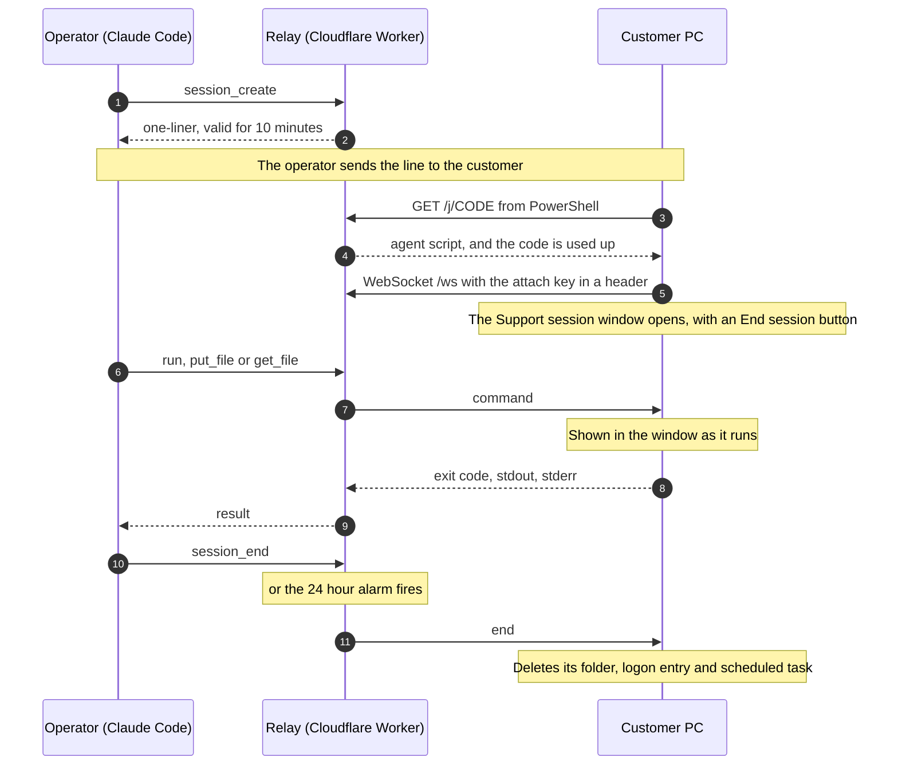
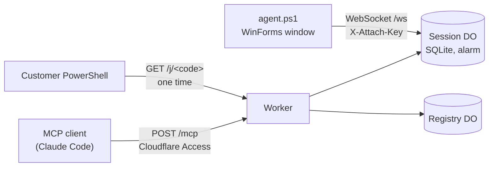

<div align="center">

# Support-MCP

**Let an AI agent fix a Windows PC.**<br>
The customer pastes one line. A window on their screen shows every command as it runs.<br>
They can stop it at any time, and after 24 hours it removes itself.

[](https://github.com/SUKARDADDY/Support-MCP/actions/workflows/test.yml)
[](LICENSE)
[](https://developers.cloudflare.com/durable-objects/)
[](src/agent.ps1)
[](#mcp-tools)


<sub>An illustration based on the <a href="#a-real-session">first real session</a>.</sub>

[How it works](#how-it-works) · [A real session](#a-real-session) · [Security model](#security-model) · [Deploy your own](#deploy-your-own)

</div>

## Why

I built it because I support Windows point-of-sale machines, and every
screen-sharing tool I tried wanted an installer, an account, or a person on the
other end reading out codes. I wanted to send a link, have the customer paste
it, and let an agent do the diagnosis while I watch.

## At a glance

- **One line, nothing to install.** The agent is a single PowerShell 5.1 script
  with no dependencies beyond what ships with Windows. No account, no codes to
  read out.
- **The customer sees everything.** Every command and file operation appears in
  their window as it happens, above an **End session** button.
- **Never elevated.** The agent refuses to run elevated. When a command asks
  for admin rights, Windows shows a UAC prompt and the customer decides.
- **Gone in 24 hours.** The session ends itself and removes the agent's folder,
  logon entry and scheduled task, even if the relay is gone.
- **No local bridge.** A Cloudflare Worker is the MCP server. Point Claude Code
  at it and you get seven tools.

## How it works

1. The operator calls `session_create`. The relay mints a single-use pairing
   code and returns a one-liner:
   ```powershell
   irm https://support.example.com/j/zp5z7xuckhrm6s7t | iex
   ```
2. The customer pastes it. The script copies itself to
   `%LOCALAPPDATA%\SupportMCP\<id>\`, opens a window titled "Support session",
   and connects back over a WebSocket.
3. The operator calls `run`, `put_file` and `get_file`. Each one appears as a
   timestamped line in the customer's window.
4. The session ends when the operator calls `session_end`, when the customer
   clicks **End session**, or when 24 hours pass. The agent then deletes its
   folder, its logon entry and its scheduled task.



The pairing link is valid for 10 minutes and can be fetched once. Only a
request from PowerShell uses the code up. A chat app that previews the link
gets a short harmless message instead. After the script is fetched, the PC has
two hours to make its first connection. `session_status` reports that deadline
as `startup_expires_at` while the session waits, and `null` in every other
state. The agent keeps the same two-hour limit on its own clock (`connect_by`
in its config), so a PC that never connects cleans up even if the relay is
gone. Once connected, the session lasts up to 24 hours, and a reconnect doesn't
extend that.

## A real session

The first customer session was a restaurant POS terminal whose receipt printer
had been swapped from one brand to another. Nothing printed. The whole fix ran
through this relay with Claude Code as the operator, from pasting the link to a
receipt coming out of the printer.

What it found, in order:

1. Windows could see the new printer on USB, but its USB printing interface
   never finished coming up, so Windows had no `USB001` port to print to. A
   spooler restart didn't help. Restarting that one USB device did, with the
   customer approving the UAC prompt.
2. The old print queue still used the previous vendor's driver, and that
   driver's language monitor sent data the new printer couldn't handle. The
   printer got stuck. It answered real-time status queries and dropped
   everything else, and neither a power cycle nor a PC reboot cleared it. The
   agent opened the USB device directly, bypassing the spooler, and sent the
   ESC/POS buffer-clear command. The printer acknowledged it and printed.
3. A fresh queue with the right vendor driver still printed nothing, because
   that driver's own language monitor expects the vendor's port type. Turning
   bidirectional support off on the queue fixed it, and the POS software's
   receipts printed.

Steps 2 and 3 can't be done from a screen share. They needed raw writes to the
device and reading status bytes back, which is what `run` makes possible.

## MCP tools

| Tool | Does |
|---|---|
| `session_create` | returns `{session_id, one_liner, code_expires_at}` |
| `session_list` | every session with its state, expiry and machine |
| `session_status` | state, machine, user, expiry, `startup_expires_at` while waiting, whether the agent is attached, last audit rows |
| `run` | runs PowerShell as the signed-in user; returns exit code, stdout, stderr, timed_out |
| `put_file` | writes base64 data to a path, with append for chunking |
| `get_file` | reads a byte range as base64, with `eof` for chunking |
| `session_end` | tells the agent to clean up and marks the session ended |

There is no screen capture and no tool that elevates. That is on purpose.

## Architecture



| Path | Auth | Purpose |
|---|---|---|
| `GET /healthz` | public | liveness |
| `GET /j/<code>` | public, single use, https only | serves the agent script with the session values filled in, to PowerShell clients only |
| `GET /ws?sid=` | attach key in a header, https only | agent WebSocket, using the hibernation API |
| `POST /mcp` | Cloudflare Access | MCP JSON-RPC 2.0, stateless HTTP |

The Worker itself is the MCP server. There is no local bridge process. Each
session is one Durable Object holding its state machine, its audit log and an
alarm for expiry. A second Durable Object keeps the list for `session_list`.

| Source file | What it does |
|---|---|
| `src/app.js` | router, Access JWT gate, MCP handler |
| `src/session.js` | `Session` Durable Object: states, audit log, alarm, tagged sockets |
| `src/registry.js` | `Registry` Durable Object for `session_list` |
| `src/mcp.js` | JSON-RPC dispatch and the tool schemas |
| `src/jwt.js` | RS256 verification of the Access JWT with WebCrypto |
| `src/template.js` | builds the served script and validates every value placed in it |
| `src/agent.ps1` | the Windows agent: bootstrap, run and cleanup roles in one file |

## Security model

The customer pastes a script from the internet into PowerShell, so the design
starts from what that script may and may not do.

- **Consent is visible.** The window stays on top when it first opens, lists
  every command and file operation, and has an **End session** button. Closing
  the window asks before it ends the session.
- **No elevation.** The agent refuses to start if its own process is elevated.
  If the customer pasted into an admin console, the bootstrap starts the agent
  through a one-shot scheduled task at the limited run level. With UAC turned
  off, or on the built-in Administrator account, that task still gets a full
  token. The agent then removes everything it installed and exits, and the
  logon entry is only written after the elevation check passes. When admin
  rights are needed, the operator can ask Windows for a UAC prompt, and the
  customer decides whether to click Yes.
- **Pairing codes can't be guessed.** A code is 16 base32 characters, 80 bits,
  single use, and valid for 10 minutes. The customer pastes it and never types
  it, so its length costs nothing.
- **Link previews can't use up a code.** Slack, Teams, WhatsApp and Telegram
  fetch links with a plain `GET`. The relay serves the script, and consumes the
  code, only when the `User-Agent` contains `PowerShell/`, which is what `irm`
  sends in Windows PowerShell 5.1 and PowerShell 7. Any other request gets a
  `Write-Host` line telling the reader to paste the command into PowerShell. This
  protects the code from bots, not from someone who sets the header on purpose.
- **https only.** The script carries the attach key and runs the whole session
  over the origin it was served from, so the relay builds that origin as
  `https://<host>` for every host except `localhost` and `127.0.0.1`. A `/j`
  request over plain http gets a `Write-Host` line asking for the https link,
  and the code stays unused. `/ws` over plain http gets a 403.
- **The attach key never goes in a URL.** It is 32 random bytes, sent only in
  the `X-Attach-Key` header so it stays out of access logs, and the relay
  stores only its SHA-256. A request with the key in the query string is
  rejected.
- **The served script can't be injected into.** Every value substituted into
  the PowerShell template is checked against a hex, base32 or URL pattern
  before it goes into a single-quoted literal. The script runs inside
  `& { ... }` so nothing leaks into the customer's console session.
- **The operator endpoint sits behind Cloudflare Access.** The relay verifies
  the Access JWT itself: RS256 signature, `aud`, `iss`, `exp` and `nbf` with 60
  seconds of skew. It caches signing keys for an hour and allows at most one
  forced refetch per minute when it sees an unknown `kid`. Requests carrying
  an `Origin` header get a 403 and non-JSON bodies get a 415, which blocks
  cross-site POSTs from a logged-in browser.
- **Sessions only move forward.** The states run pending, consumed, attached,
  ended, and `ended` is final. The 24-hour limit starts at the first attach and
  a reattach does not extend it. Every handler checks the deadline inline, so a
  late alarm can't let an expired session act.
- **Cleanup has three layers.** The relay alarm sends `end`. The agent
  remembers its own deadline and cleans up on restart. That deadline is the
  session expiry once connected, and `connect_by` (two hours after the script
  ran) until then. A per-user scheduled task runs the cleanup at the same
  deadline even if the agent was killed, and it still fires on battery or after
  sleep. The first welcome from the relay moves the task from `connect_by` to
  the real expiry.
- **Everything is audited.** Each session records created, consumed, attached,
  every `run` with its command text (cut to 512 characters), file operations
  with path and size but not content, and the reason it ended. Rows for
  operator actions name the caller identity from the JWT. The machine, user
  and PowerShell version the agent reports are cut to 100, 100 and 40
  characters, and only the first `hello` on each socket counts.
- **Session output is untrusted input.** Everything that comes back from a
  session is written by the customer's PC: stdout, stderr, file contents, and
  the machine and user names. Treat it as untrusted text that may try to steer
  the operator's AI agent. That agent can have a shell on the operator's own
  machine, so do not run it with tool calls auto-approved.
- **The window shows, it does not enforce.** The window shows what the operator
  does. It does not stop an operator acting in bad faith: commands run with the
  signed-in user's rights, and what they change stays changed. "Removes the
  agent's own files" covers only the agent's folder, logon entry and scheduled
  tasks. It does not undo files an operator wrote, software it installed or
  settings it changed.

## Deploy your own

You need a Cloudflare account with a zone for the hostname, Node 22 and
`wrangler`.

1. **Create the Access guard for `/mcp`.** This makes a service token for the
   MCP client and an Access app with two policies, your email and the token.
   ```sh
   CLOUDFLARE_API_TOKEN=... CLOUDFLARE_ACCOUNT_ID=... \
   SUPPORT_HOST=support.example.com SUPPORT_OPERATOR_EMAIL=you@example.com \
   cf/access-setup.sh
   ```
   The API token needs Access: Apps and Policies (Edit) and Access: Service
   Tokens (Edit). The script writes the client secret to
   `~/.config/support-mcp/access.env` with mode 600, never prints it, and
   prints the app's AUD tag at the end.
2. **Fill in `wrangler.toml`.** Set the route hostname, `ACCESS_TEAM_DOMAIN`
   and `ACCESS_AUD`, then run `npx wrangler deploy`.
3. **Harden the zone.** Turn on **Always Use HTTPS** for the zone (SSL/TLS,
   Edge Certificates), so a link pasted without `https://` is redirected. The
   relay refuses `/j` and `/ws` over plain http either way. The relay does no
   rate limiting of its own, so add a Cloudflare rate-limiting rule on `/j` and
   `/ws`.
4. **Connect Claude Code.** The headers helper reads the secret at connect
   time, so it never lands in `~/.claude.json`:
   ```sh
   claude mcp add-json -s user support-mcp \
     '{"type":"http","url":"https://support.example.com/mcp","headersHelper":"/path/to/Support-MCP/cf/mcp-headers.sh"}'
   ```

## Develop and test

```sh
node --test                          # 56 unit and route tests, no network
npx wrangler deploy --dry-run --outdir /tmp/support-mcp-dry
cp .dev.vars.example .dev.vars && npx wrangler dev --port 8787
```

`.dev.vars` skips Access and shortens the session TTL, but only when the
request host is `localhost` or `127.0.0.1`. The deployed hostname can never
satisfy that check. Keep `wrangler dev` on loopback, its default: the bypass
trusts the `Host` header, so anyone who can reach a dev server on another
interface could send `Host: localhost` and skip Access.

`wrangler dev` presents the custom-domain route's hostname to the Worker, so to
exercise `/mcp`, `/j` or `/ws` locally, run it against a copy of the config
with the `routes` line removed. Over plain http the relay serves only
`localhost` and `127.0.0.1`.

The route tests import the real router. Most give it Durable Object bindings
that throw if touched. That proves the Access gate, the `Origin` check, the
method checks, the https check and the link-preview check all run before any
session state is read. The few `/j` tests that must reach a session use a stub
binding that records every call.

The wire protocol, the state machine and the acceptance checks are in
[`docs/relay-v1-spec.md`](docs/relay-v1-spec.md).

## Limits

- Windows only. The agent targets Windows PowerShell 5.1, which ships with
  Windows 10 and 11.
- The script isn't signed. `irm | iex` content has no Mark of the Web, so
  SmartScreen doesn't apply, but Defender heuristics could still flag it on
  some machines.
- It is built for one operator, or a few people sharing one Access app. There
  are no per-operator permissions.
- Command output is capped at 262,144 characters per stream, and the whole
  result frame is trimmed to fit the WebSocket message limit. Files move in
  chunks of about 512 KiB.
- If a command leaves a background process running that keeps its output open,
  the agent waits about 5 seconds after the command exits and stops that
  process if it can find it. Output on a stream that process still holds open
  is discarded, and the result is marked with an `[output incomplete]` note. A
  process started with `Start-Process -NoNewWindow` and no `-Wait` is stopped
  about 5 seconds after the command returns, so use `-Wait`, or plain
  `Start-Process` (which does not share the output pipe), for programs that
  must keep running.
- If Task Scheduler is unavailable, no fallback cleanup task exists, whether
  the agent has connected or not. An agent that is killed is then cleaned up
  the next time it starts after its deadline, normally at logon.
- Where an administrator has turned on PowerShell script block logging, Windows
  may record the served script, including the attach key, in the PowerShell
  Operational event log. The key stays valid for the life of the session.

## Responsible use

- Use it only on a computer whose owner has asked for support and agreed to
  the session.
- The visible window and the **End session** button are the consent mechanism.
  They show the customer every command and let them stop the session at any
  time. Please keep them visible in any fork.
- You are responsible for following the law where you and the customer are.

## Contributing

Only collaborators can open pull requests here. To suggest a change or report
a bug, open an issue. To report a vulnerability, see [SECURITY.md](SECURITY.md).

## License

[MIT](LICENSE).
