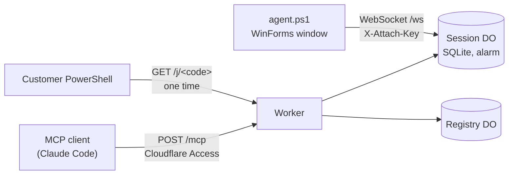

# Support-MCP

Remote support for Windows PCs, run by an AI agent over the Model Context
Protocol. The customer pastes one line into PowerShell. A small window opens on
their screen and shows every command as it runs. The operator, which in my case
is Claude Code, gets seven MCP tools to run commands and move files on that PC.
The session ends itself after 24 hours and leaves nothing installed.

I built it because I support Windows point-of-sale machines, and every
screen-sharing tool I tried wanted an installer, an account, or a person on the
other end reading out codes. I wanted to send a link, have the customer paste
it, and let an agent do the diagnosis while I watch.

The relay is a Cloudflare Worker with Durable Objects. The agent is a single
PowerShell 5.1 script with no dependencies beyond what ships with Windows.

## What a session looks like

1. The operator calls `session_create`. The relay mints a single-use pairing
   code and returns a one-liner:
   ```powershell
   irm https://support.example.com/j/zp5z7xuckhrm6s7t | iex
   ```
2. The customer pastes it. The script copies itself to
   `%LOCALAPPDATA%\SupportMCP\<id>\`, opens a window titled "Support session",
   and connects back over a WebSocket.
3. The operator calls `run`, `put_file` and `get_file`. Each one appears as a
   timestamped line in the customer's window.
4. The session ends when the operator calls `session_end`, when the customer
   clicks **End session**, or when 24 hours pass. The agent then deletes its
   folder, its logon entry and its scheduled task.

## Architecture



| Path | Auth | Purpose |
|---|---|---|
| `GET /healthz` | public | liveness |
| `GET /j/<code>` | public, single use | serves the agent script with the session values filled in |
| `GET /ws?sid=` | attach key in a header | agent WebSocket, using the hibernation API |
| `POST /mcp` | Cloudflare Access | MCP JSON-RPC 2.0, stateless HTTP |

The Worker itself is the MCP server. There is no local bridge process. Each
session is one Durable Object holding its state machine, its audit log and an
alarm for expiry. A second Durable Object keeps the list for `session_list`.

| Source file | What it does |
|---|---|
| `src/app.js` | router, Access JWT gate, MCP handler |
| `src/session.js` | `Session` Durable Object: states, audit log, alarm, tagged sockets |
| `src/registry.js` | `Registry` Durable Object for `session_list` |
| `src/mcp.js` | JSON-RPC dispatch and the tool schemas |
| `src/jwt.js` | RS256 verification of the Access JWT with WebCrypto |
| `src/template.js` | builds the served script and validates every value placed in it |
| `src/agent.ps1` | the Windows agent: bootstrap, run and cleanup roles in one file |

## MCP tools

| Tool | Does |
|---|---|
| `session_create` | returns `{session_id, one_liner, code_expires_at}` |
| `session_list` | every session with its state, expiry and machine |
| `session_status` | state, machine, user, expiry, whether the agent is attached, last audit rows |
| `run` | runs PowerShell as the signed-in user; returns exit code, stdout, stderr, timed_out |
| `put_file` | writes base64 data to a path, with append for chunking |
| `get_file` | reads a byte range as base64, with `eof` for chunking |
| `session_end` | tells the agent to clean up and marks the session ended |

There is no screen capture and no tool that elevates. That is on purpose.

## Security model

The customer pastes a script from the internet into PowerShell, so the design
starts from what that script may and may not do.

- **Consent is visible.** The window stays on top when it first opens, lists
  every command and file operation, and has an **End session** button. Closing
  the window asks before it ends the session.
- **No elevation.** The agent refuses to start if its own process is elevated.
  If the customer pasted into an admin console, the bootstrap starts the agent
  through a one-shot scheduled task at the limited run level. When admin rights
  are needed, the operator can ask Windows for a UAC prompt, and the customer
  decides whether to click Yes.
- **Pairing codes can't be guessed.** A code is 16 base32 characters, 80 bits,
  single use, and valid for 10 minutes. The customer pastes it and never types
  it, so its length costs nothing.
- **The attach key never goes in a URL.** It is 32 random bytes, sent only in
  the `X-Attach-Key` header so it stays out of access logs, and the relay
  stores only its SHA-256. A request with the key in the query string is
  rejected.
- **The served script can't be injected into.** Every value substituted into
  the PowerShell template is checked against a hex, base32 or URL pattern
  before it goes into a single-quoted literal. The script runs inside
  `& { ... }` so nothing leaks into the customer's console session.
- **The operator endpoint sits behind Cloudflare Access.** The relay verifies
  the Access JWT itself: RS256 signature, `aud`, `iss`, `exp` and `nbf` with 60
  seconds of skew. It caches signing keys for an hour and allows at most one
  forced refetch per minute when it sees an unknown `kid`. Requests carrying
  an `Origin` header get a 403 and non-JSON bodies get a 415, which blocks
  cross-site POSTs from a logged-in browser.
- **Sessions only move forward.** The states run pending, consumed, attached,
  ended, and `ended` is final. The 24-hour limit starts at the first attach and
  a reattach does not extend it. Every handler checks the deadline inline, so a
  late alarm can't let an expired session act.
- **Cleanup has three layers.** The relay alarm sends `end`. The agent
  remembers its own expiry and cleans up on restart. A per-user scheduled task
  runs the cleanup at expiry even if the agent was killed, and it still fires
  on battery or after sleep.
- **Everything is audited.** Each session records created, consumed, attached,
  every `run` with its command text, file operations with path and size but not
  content, and the reason it ended. Rows for operator actions name the caller
  identity from the JWT.

## A real session

The first customer session was a restaurant POS terminal whose receipt printer
had been swapped from one brand to another. Nothing printed. The whole fix ran
through this relay with Claude Code as the operator, from pasting the link to a
receipt coming out of the printer.

What it found, in order:

1. Windows could see the new printer on USB, but its USB printing interface
   never finished coming up, so Windows had no `USB001` port to print to. A
   spooler restart didn't help. Restarting that one USB device did, with the
   customer approving the UAC prompt.
2. The old print queue still used the previous vendor's driver, and that
   driver's language monitor sent data the new printer couldn't handle. The
   printer got stuck. It answered real-time status queries and dropped
   everything else, and neither a power cycle nor a PC reboot cleared it. The
   agent opened the USB device directly, bypassing the spooler, and sent the
   ESC/POS buffer-clear command. The printer acknowledged it and printed.
3. A fresh queue with the right vendor driver still printed nothing, because
   that driver's own language monitor expects the vendor's port type. Turning
   bidirectional support off on the queue fixed it, and the POS software's
   receipts printed.

Steps 2 and 3 can't be done from a screen share. They needed raw writes to the
device and reading status bytes back, which is what `run` makes possible.

## Deploy your own

You need a Cloudflare account with a zone for the hostname, Node 22 and
`wrangler`.

1. **Create the Access guard for `/mcp`.** This makes a service token for the
   MCP client and an Access app with two policies, your email and the token.
   ```sh
   CLOUDFLARE_API_TOKEN=... CLOUDFLARE_ACCOUNT_ID=... \
   SUPPORT_HOST=support.example.com SUPPORT_OPERATOR_EMAIL=you@example.com \
   cf/access-setup.sh
   ```
   The API token needs Access: Apps and Policies (Edit) and Access: Service
   Tokens (Edit). The script writes the client secret to
   `~/.config/support-mcp/access.env` with mode 600, never prints it, and
   prints the app's AUD tag at the end.
2. **Fill in `wrangler.toml`.** Set the route hostname, `ACCESS_TEAM_DOMAIN`
   and `ACCESS_AUD`, then run `npx wrangler deploy`.
3. **Connect Claude Code.** The headers helper reads the secret at connect
   time, so it never lands in `~/.claude.json`:
   ```sh
   claude mcp add-json -s user support-mcp \
     '{"type":"http","url":"https://support.example.com/mcp","headersHelper":"/path/to/Support-MCP/cf/mcp-headers.sh"}'
   ```

## Develop and test

```sh
node --test                          # 36 unit and route tests, no network
npx wrangler deploy --dry-run --outdir /tmp/support-mcp-dry
cp .dev.vars.example .dev.vars && npx wrangler dev --port 8787
```

`.dev.vars` skips Access and shortens the session TTL, but only when the
request host is `localhost` or `127.0.0.1`. The deployed hostname can never
satisfy that check. `wrangler dev` presents the custom-domain route's hostname
to the Worker, so to exercise `/mcp` locally, run it against a copy of the
config with the `routes` line removed.

The route tests import the real router with Durable Object bindings that throw
if touched. That proves the Access gate, the `Origin` check and the method
checks all run before any session state is read.

The wire protocol, the state machine and the acceptance checks are in
[`docs/relay-v1-spec.md`](docs/relay-v1-spec.md).

## Limits

- Windows only. The agent targets Windows PowerShell 5.1, which ships with
  Windows 10 and 11.
- The script isn't signed. `irm | iex` content has no Mark of the Web, so
  SmartScreen doesn't apply, but Defender heuristics could still flag it on
  some machines.
- It is built for one operator, or a few people sharing one Access app. There
  are no per-operator permissions.
- Command output is capped at 256 KiB per stream and files move in chunks of
  about 512 KiB.

## License

[MIT](LICENSE)
