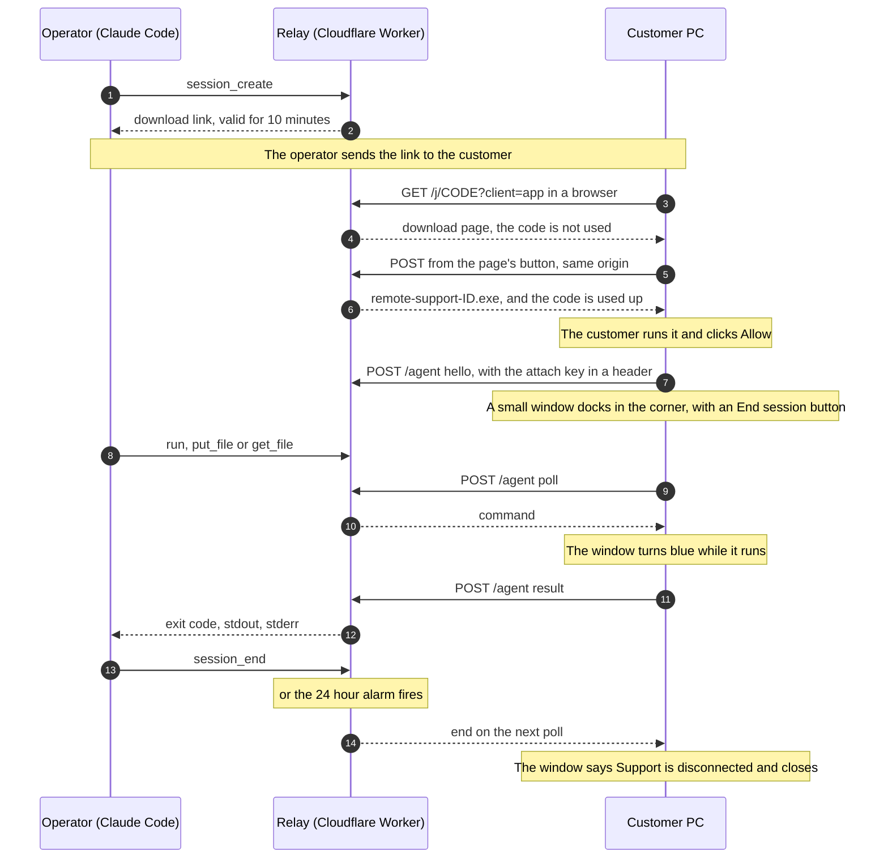
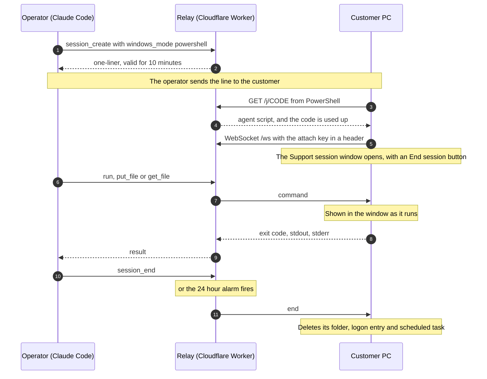
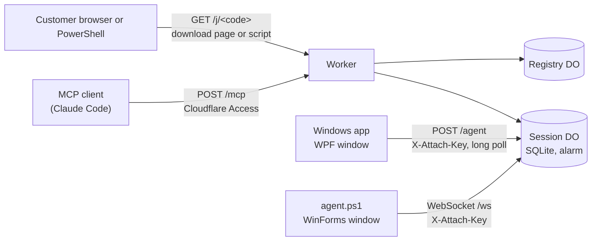

<div align="center">

# Support-MCP

**Let an AI agent fix a Windows PC.**<br>
The customer opens a link, downloads a small app and clicks Allow. A window stays in the corner of their screen while support is connected.<br>
They can stop it at any time, and after 24 hours access ends by itself.

[](https://github.com/SUKARDADDY/Support-MCP/actions/workflows/test.yml)
[](LICENSE)
[](https://developers.cloudflare.com/durable-objects/)
[](src/agent-app.cs)
[](src/agent.ps1)
[](#mcp-tools)


<sub>An illustration based on the <a href="#a-real-session">first real session</a>, shown with the downloaded app.</sub>

[How it works](#how-it-works) · [A real session](#a-real-session) · [Security model](#security-model) · [Deploy your own](#deploy-your-own)

</div>

## Why

I built it because I support Windows point-of-sale machines, and every
screen-sharing tool I tried wanted an installer, an account, or a person on the
other end reading out codes. I wanted to send a link, have the customer open it,
and let an agent do the diagnosis while I watch.

## At a glance

- **A link and one download.** The customer opens a link, downloads one small
  executable and clicks **Allow**. It runs as the signed-in user, with no
  installer and no account, on Windows 10 and 11. Windows 7 and 8.1 need .NET
  Framework 4.5.2 or later first (see [Limits](#limits)). There is no code to
  read out. A PowerShell one-liner for Windows 8 and later is the
  [alternative](#the-powershell-alternative).
- **The customer stays in control.** Nothing connects until they click **Allow**
  in a consent dialog, where **Don't allow** is the default. A window in the
  corner of the screen shows that support is connected and for how long, turns
  blue while a command runs, and has an **End session** button.
- **Never elevated on its own.** Neither client asks Windows for administrator
  rights. When a command asks for them, Windows shows a UAC prompt and the
  customer decides.
- **Gone in 24 hours.** The session ends at a fixed deadline, even if the
  customer never closes the window.
- **No local bridge.** A Cloudflare Worker is the MCP server. Point Claude Code
  at it and you get seven tools.
- **Unsigned.** The app has no code signature, so Windows SmartScreen shows
  "Windows protected your PC" until you sign it. See
  [Unsigned app](#unsigned-app).

## How it works

1. The operator calls `session_create`. The relay mints a single-use pairing
   code and returns a link:
   ```
   https://support.example.com/j/zp5z7xuckhrm6s7t?client=app
   ```
   The result also has `one_liner`, a `Start-Process '<link>'` command for a
   PowerShell console on the customer's PC, which works in PowerShell 2.0.
2. The customer opens the link. The page explains the three steps in English
   and Hebrew and has a **Download the support app** button. Opening or
   refreshing the page does not use the code.
3. The button submits a same-origin form. The relay then returns
   `remote-support-<id>.exe`: the app with this session's configuration
   appended. The code is used up.
4. The customer opens the file. If Windows says "Windows protected your PC",
   they click **More info**, then **Run anyway**. They click **Allow** in the
   consent dialog. The app connects back over HTTPS and a small window docks in
   the bottom-right corner.
5. The operator calls `run`, `put_file` and `get_file`. The window turns blue
   while one runs. It never shows the commands, paths or output.
6. The session ends when the operator calls `session_end`, when the customer
   clicks **End session** (after an inline "End the session?" check), or when 24
   hours pass. The window says "Support is disconnected." and closes after four
   seconds. The app leaves nothing installed. The downloaded file stays in
   Downloads, and the customer can delete it.



The pairing link is valid for 10 minutes and can be used once. After the app is
downloaded, the PC has two hours to make its first connection.
`session_status` reports that deadline as `startup_expires_at` while the session
waits, and `null` in every other state. Once connected, the session lasts up to
24 hours, and a reconnect does not extend that. The app keeps the deadline on
its own clock and stops connecting when it passes.

### The PowerShell alternative

Call `session_create` with `windows_mode: "powershell"` to get a one-liner for
Windows 8 and later, with nothing to download:

```powershell
irm https://support.example.com/j/zp5z7xuckhrm6s7t | iex
```

The customer pastes it. The script copies itself to
`%LOCALAPPDATA%\SupportMCP\<id>\`, opens a window titled "Support session",
and connects back over a WebSocket. Unlike the app, that window lists every
command and file operation as it runs, above an **End session** button. It also
registers a logon entry and a scheduled task so it can clean up after a reboot
or a killed process.



For the PowerShell path, only a request from PowerShell uses the code up. A chat
app that previews the link gets a short harmless message instead. The agent
keeps the same two-hour first-connection limit on its own clock (`connect_by`
in its config), so a PC that never connects cleans up even if the relay is
gone.

### Windows modes

`session_create` takes `windows_mode`. `session_status` reports the same
canonical name.

| Value | Customer does | Works on |
|---|---|---|
| `app` (default) | opens a link, downloads and runs the app, clicks Allow | Windows 7 to 11 (7 and 8.1 need .NET Framework 4.5.2 or later; 7 also needs TLS 1.2 enabled) |
| `powershell` | pastes one line | Windows 8 and later |

`legacy` is an alias for `app` and `standard` is an alias for `powershell`, so
operator calls written for other deployments still work. The link's
`?client=app` also accepts `?client=legacy`. Any other value is an error.

## A real session

The first customer session was a restaurant POS terminal whose receipt printer
had been swapped from one brand to another. Nothing printed. The whole fix ran
through this relay with Claude Code as the operator, from the customer opening
the link to a receipt coming out of the printer. That session used the
PowerShell one-liner, which was the only client then.

What it found, in order:

1. Windows could see the new printer on USB, but its USB printing interface
   never finished coming up, so Windows had no `USB001` port to print to. A
   spooler restart didn't help. Restarting that one USB device did, with the
   customer approving the UAC prompt.
2. The old print queue still used the previous vendor's driver, and that
   driver's language monitor sent data the new printer couldn't handle. The
   printer got stuck. It answered real-time status queries and dropped
   everything else, and neither a power cycle nor a PC reboot cleared it. The
   agent opened the USB device directly, bypassing the spooler, and sent the
   ESC/POS buffer-clear command. The printer acknowledged it and printed.
3. A fresh queue with the right vendor driver still printed nothing, because
   that driver's own language monitor expects the vendor's port type. Turning
   bidirectional support off on the queue fixed it, and the POS software's
   receipts printed.

Steps 2 and 3 can't be done from a screen share. They needed raw writes to the
device and reading status bytes back, which is what `run` makes possible.

## MCP tools

| Tool | Does |
|---|---|
| `session_create` | `windows_mode` `app` (default) returns `{session_id, windows_mode, download_url, one_liner, code_expires_at}`; `powershell` returns `{session_id, windows_mode, one_liner, code_expires_at}` |
| `session_list` | every session with its state, expiry and machine |
| `session_status` | state, `windows_mode`, machine, user, expiry, `startup_expires_at` while waiting, whether the client is attached, `elevated` for app sessions, last audit rows |
| `run` | runs PowerShell as the signed-in user (with administrator rights only if the customer started the app as Administrator and approved it); returns exit code, stdout, stderr, timed_out |
| `put_file` | writes base64 data to a path, with append for chunking |
| `get_file` | reads a byte range as base64, with `eof` for chunking |
| `session_end` | tells the client to stop and marks the session ended |

There is no screen capture and no tool that elevates. That is on purpose.

## Architecture



| Path | Auth | Purpose |
|---|---|---|
| `GET /healthz` | public | liveness |
| `GET /j/<code>?client=app` | public, https only | the download page. Never uses the code up |
| `POST /j/<code>?client=app` | public, single use, https only, same origin | returns the session's executable and uses the code up |
| `GET /j/<code>` | public, single use, https only | serves the PowerShell agent script with the session values filled in, to PowerShell clients only |
| `POST /agent?sid=` | attach key in a header, https only | the app's transport: hello, long poll, results and end, as JSON |
| `GET /ws?sid=` | attach key in a header, https only | PowerShell agent WebSocket, using the hibernation API |
| `POST /mcp` | Cloudflare Access | MCP JSON-RPC 2.0, stateless HTTP |

The Worker itself is the MCP server. There is no local bridge process. Each
session is one Durable Object holding its state machine, its audit log and an
alarm for expiry. A second Durable Object keeps the list for `session_list`.

| Source file | What it does |
|---|---|
| `src/app.js` | router, Access JWT gate, MCP handler, download page |
| `src/session.js` | `Session` Durable Object: states, audit log, alarm, tagged sockets, the app's polling transport |
| `src/registry.js` | `Registry` Durable Object for `session_list` |
| `src/mcp.js` | JSON-RPC dispatch and the tool schemas |
| `src/jwt.js` | RS256 verification of the Access JWT with WebCrypto |
| `src/template.js` | builds the served script and the downloaded executable, validates every value placed in them, and maps the mode aliases |
| `src/agent-app.cs` | the Windows app: C# source for .NET Framework 4.5.2 or later, WPF window, consent dialog, HTTPS polling client |
| `src/agent-app.manifest` | the app's `asInvoker` manifest (never asks for elevation) |
| `src/app-bundle.json` | the compiled x86 app with the SHA-256 of its source and manifest. Tests fail when the source changed without a rebuild |
| `src/agent.ps1` | the PowerShell agent: bootstrap, run and cleanup roles in one file |
| `scripts/build-app.ps1` | builds `src/app-bundle.json` on Windows with the built-in compiler |
| `scripts/prepare-app-restart.ps1` | optional: one automatic reconnect after a restart the customer authorized |
| `test/app-native.cs` | native tests for the app, compiled and run on Windows |

## Security model

The customer runs a program that came from a link, so the design starts from
what that program may and may not do. The app is the default. Bullets that
apply to only one client say which.

- **Consent is explicit.** The app does nothing until the customer clicks
  **Allow** in a dialog that says what access they are giving. **Don't allow**
  is selected by default, and only a click on Allow grants access.
- **The window shows that access exists.** The app's window stays on top in the
  bottom-right corner while support is connected. It shows a running timer and
  when the session ends by itself, turns blue while a command or file operation
  runs, and has an **End session** button. It never shows commands, paths or
  output. End session, Alt+F4 and the taskbar Close all ask "End the session?"
  first. The PowerShell agent's window is different: it lists every command and
  file operation as it runs.
- **No elevation by the app.** The manifest is `asInvoker`, so Windows never
  shows a UAC prompt for the app itself and no code path asks for elevation. If
  the customer starts it with Run as administrator anyway, it asks a second,
  explicit question before connecting, with No selected by default. The window
  then says "Running with administrator rights.", and `session_status` reports
  `elevated: true`. Commands inherit that token.
- **No elevation by the PowerShell agent.** The agent refuses to start if its own process is elevated.
  If the customer pasted into an admin console, the bootstrap starts the agent
  through a one-shot scheduled task at the limited run level. With UAC turned
  off, or on the built-in Administrator account, that task still gets a full
  token. The agent then removes everything it installed and exits, and the
  logon entry is only written after the elevation check passes. When admin
  rights are needed, the operator can ask Windows for a UAC prompt, and the
  customer decides whether to click Yes.
- **Pairing codes can't be guessed.** A code is 16 base32 characters, 80 bits,
  single use, and valid for 10 minutes. The customer pastes it and never types
  it, so its length costs nothing.
- **Link previews can't use up a code.** Slack, Teams, WhatsApp and Telegram
  fetch links with a plain `GET`. The download page is served on `GET` and never
  touches the code. Only a `POST` from the page's button consumes it, and the
  relay accepts that `POST` only when its `Origin` header is the relay's own
  origin. The page sends `Referrer-Policy: same-origin` so browsers keep that
  header on the click, `Cache-Control: no-store`, and a content security policy
  with `default-src 'none'`, no scripts and `form-action 'self'`. A second click
  gets a "Check your downloads" page, not a second file. For the PowerShell
  link, the relay serves the script, and consumes the code, only when the
  `User-Agent` contains `PowerShell/`, which is what `irm` sends in Windows
  PowerShell 5.1 and PowerShell 7. Any other request gets a `Write-Host` line
  telling the reader to paste the command into PowerShell. That check protects
  the code from bots, not from someone who sets the header on purpose.
- **A code only works for its own client.** A code minted for the app cannot be
  used up by `irm`, a PowerShell code cannot be used up by the download page,
  and a session refuses the other client's transport.
- **https only.** The script and the app both carry the attach key and run the
  whole session over the origin they were served from, so the relay builds that
  origin as `https://<host>` for every host except `localhost` and `127.0.0.1`.
  A PowerShell `/j` request over plain http gets a `Write-Host` line asking for
  the https link, an app `/j` request gets a 403, and the code stays unused in
  both cases. `/ws` and `/agent` over plain http get a 403. The app also refuses
  to run against any origin that is not https, loopback excepted.
- **The attach key never goes in a URL.** It is 32 random bytes, sent only in
  the `X-Attach-Key` header so it stays out of access logs, and the relay
  stores only its SHA-256. A request with the key in the query string is
  rejected. The app's copy of the key lives in the downloaded file, which is
  specific to one session. `/agent` also rejects any request that carries an
  `Origin` header, any body that is not JSON, and any body over 750,000
  characters.
- **Nothing served can be injected into.** Every value substituted into the
  PowerShell template is checked against a hex, base32 or URL pattern before it
  goes into a single-quoted literal. The script runs inside `& { ... }` so
  nothing leaks into the customer's console session. The values appended to the
  app are checked the same way before they are written as JSON.
- **The operator endpoint sits behind Cloudflare Access.** The relay verifies
  the Access JWT itself: RS256 signature, `aud`, `iss`, `exp` and `nbf` with 60
  seconds of skew. It caches signing keys for an hour and allows at most one
  forced refetch per minute when it sees an unknown `kid`. Requests carrying
  an `Origin` header get a 403 and non-JSON bodies get a 415, which blocks
  cross-site POSTs from a logged-in browser.
- **Sessions only move forward.** The states run pending, consumed, attached,
  ended, and `ended` is final. The 24-hour limit starts at the first attach and
  a reattach does not extend it. Every handler checks the deadline inline, so a
  late alarm can't let an expired session act. A delayed `hello` from the app
  can't bring an ended session back, because the relay checks again after it
  hashes the key and reads the body. A reconnect gets a new generation, and a
  request from an older one gets a 409.
- **The app leaves nothing behind.** It installs no service, scheduled task or
  logon entry, so restarting the PC ends access, and it deletes its temporary
  command folder on exit. A command runs inside a Windows Job Object, so a
  timeout, an end or the app exiting kills the whole process tree. The
  optional restart-reconnect script is the one exception, and it needs the
  customer's approval for one reconnect.
- **PowerShell cleanup has three layers.** The relay alarm sends `end`. The agent
  remembers its own deadline and cleans up on restart. That deadline is the
  session expiry once connected, and `connect_by` (two hours after the script
  ran) until then. A per-user scheduled task runs the cleanup at the same
  deadline even if the agent was killed, and it still fires on battery or after
  sleep. The first welcome from the relay moves the task from `connect_by` to
  the real expiry.
- **Everything is audited.** Each session records created, consumed, attached,
  every `run` with its command text (cut to 512 characters), file operations
  with path and size but not content, and the reason it ended. Rows for
  operator actions name the caller identity from the JWT. The machine, user
  and PowerShell version the client reports are cut to 100, 100 and 40
  characters. On the WebSocket only the first `hello` on each socket counts.
  An app `hello` writes an `attached` row with the reported rights and a
  `hello` row.
- **Session output is untrusted input.** Everything that comes back from a
  session is written by the customer's PC: stdout, stderr, file contents, and
  the machine and user names. Treat it as untrusted text that may try to steer
  the operator's AI agent. That agent can have a shell on the operator's own
  machine, so do not run it with tool calls auto-approved.
- **The window shows, it does not enforce.** The window shows that support is
  connected and working, and the consent dialog says what access is granted. It
  does not stop an operator acting in bad faith: commands run with the signed-in
  user's rights, and what they change stays changed. The PowerShell agent's
  cleanup covers only its own folder, logon entry and scheduled tasks, and the
  app's covers its temporary folder. Neither undoes files an operator wrote,
  software it installed or settings it changed.
- **The app is unsigned.** See [Unsigned app](#unsigned-app). Anyone can ask the
  customer to run an unsigned program, so tell the customer who you are before
  you send the link.

## Unsigned app

The downloaded app has no code signature, and the repository does not ship a
signing key. A browser may warn about the download, and Windows SmartScreen
shows "Windows protected your PC" when the customer opens it. The download page
tells them to click **More info**, then **Run anyway**. The warning goes away
only when you sign the app with a certificate your customers' Windows trusts.
Signing, for example with `signtool`, is out of scope for this repository.

## Deploy your own

You need a Cloudflare account with a zone for the hostname, Node 22 and
`wrangler`. The repository includes a built `src/app-bundle.json`, so you can
deploy without Windows. You need Windows only to change the app: see
[Build the app](#build-the-app).

1. **Create the Access guard for `/mcp`.** This makes a service token for the
   MCP client and an Access app with two policies, your email and the token.
   ```sh
   CLOUDFLARE_API_TOKEN=... CLOUDFLARE_ACCOUNT_ID=... \
   SUPPORT_HOST=support.example.com SUPPORT_OPERATOR_EMAIL=you@example.com \
   cf/access-setup.sh
   ```
   The API token needs Access: Apps and Policies (Edit) and Access: Service
   Tokens (Edit). The script writes the client secret to
   `~/.config/support-mcp/access.env` with mode 600, never prints it, and
   prints the app's AUD tag at the end.
2. **Fill in `wrangler.toml`.** Set the route hostname, `ACCESS_TEAM_DOMAIN`
   and `ACCESS_AUD`, then run `npx wrangler deploy`.
3. **Harden the zone.** Turn on **Always Use HTTPS** for the zone (SSL/TLS,
   Edge Certificates), so a link pasted without `https://` is redirected. The
   relay refuses `/j` and `/ws` over plain http either way. The relay does no
   rate limiting of its own, so add a Cloudflare rate-limiting rule on `/j` and
   `/ws`.
4. **Connect Claude Code.** The headers helper reads the secret at connect
   time, so it never lands in `~/.claude.json`:
   ```sh
   claude mcp add-json -s user support-mcp \
     '{"type":"http","url":"https://support.example.com/mcp","headersHelper":"/path/to/Support-MCP/cf/mcp-headers.sh"}'
   ```

## Build the app

`src/app-bundle.json` is the compiled app. It is built from `src/agent-app.cs`
and `src/agent-app.manifest` on a Windows machine with the .NET Framework 4
compiler (`csc.exe` v4.0.30319). The app needs .NET Framework 4.5.2 or later and
TLS 1.2 at run time. Windows 10 and 11 include both. Windows 8.1 ships .NET 4.5.1
and needs the 4.5.2 update. Windows 7 ships only .NET 3.5.1, so a Windows 7 PC
needs .NET Framework 4.5.2 or later installed, and TLS 1.2 enabled, before the
app will run:

```powershell
powershell.exe -NoProfile -File scripts\build-app.ps1
```

The script targets x86, references the WPF assemblies, embeds the `asInvoker`
manifest, compiles with warnings as errors, and writes the executable (base64)
and the SHA-256 of the source and manifest into the bundle. `node --test` fails
when either hash no longer matches, so it catches a source change that was
committed without a rebuild. It cannot prove that the committed executable was
compiled from that source: the test only compares the hashes the builder wrote,
and compiler output is not reproducible. If you need that assurance, rebuild the
executable yourself with `scripts/build-app.ps1` before you deploy, and commit
or deploy your own bundle. Commit the rebuilt bundle with any source change.

The native tests compile `test/app-native.cs` together with `src/agent-app.cs`
on Windows, using the same references plus `/main:AppTests /target:exe`, and run
the result. They start the real client against a fake relay and exercise HTTP
operations, Unicode, chunking, retry deduplication, process-tree cancellation,
timeout, local expiry and the reconnect rules. They need a Windows desktop
session, so they are not part of `node --test`. The first connection from a
real Windows 7 PC still needs a live check for that image's TLS 1.2 and
certificate setup.

An operator can prepare one automatic reconnect after a restart the customer
authorized. `scripts/prepare-app-restart.ps1` runs inside the live session on
the customer's PC, combines the tested app payload with the existing downloaded
configuration (the attach key never leaves the PC), and asks the customer to
approve one reconnect with the same rights at the next sign-in. The reconnect
cannot extend the session's original 24-hour deadline, and End session or the
operator ending the session cancels it.

## Develop and test

```sh
node --test                          # 84 unit and route tests, no network
npx wrangler deploy --dry-run --outdir /tmp/support-mcp-dry
cp .dev.vars.example .dev.vars && npx wrangler dev --port 8787
```

`.dev.vars` skips Access and shortens the session TTL, but only when the
request host is `localhost` or `127.0.0.1`. The deployed hostname can never
satisfy that check. Keep `wrangler dev` on loopback, its default: the bypass
trusts the `Host` header, so anyone who can reach a dev server on another
interface could send `Host: localhost` and skip Access.

`wrangler dev` presents the custom-domain route's hostname to the Worker, so to
exercise `/mcp`, `/j` or `/ws` locally, run it against a copy of the config
with the `routes` line removed. Over plain http the relay serves only
`localhost` and `127.0.0.1`.

The route tests import the real router. Most give it Durable Object bindings
that throw if touched. That proves the Access gate, the `Origin` check, the
method checks, the https check and the link-preview check all run before any
session state is read. The few `/j` tests that must reach a session use a stub
binding that records every call.

`test/app.test.js` covers the app: the bundle's hashes, the download flow and
its security headers, the polling transport, and the default mode and aliases.

The wire protocol, the state machine and the acceptance checks are in
[`docs/relay-v1-spec.md`](docs/relay-v1-spec.md).

## Limits

- Windows only. The app needs .NET Framework 4.5.2 or later and working TLS 1.2
  with the normal Windows certificate checks, and runs on Windows 7 to 11.
  Windows 10 and 11 include both. Windows 8.1 ships .NET 4.5.1 and needs the
  4.5.2 update. Windows 7 ships only .NET 3.5.1, so it needs .NET Framework
  4.5.2 or later installed first, and TLS 1.2 enabled. The
  PowerShell agent targets Windows PowerShell 5.1, which ships with Windows 10
  and 11.
- Nothing is signed. The app shows a SmartScreen warning (see
  [Unsigned app](#unsigned-app)). `irm | iex` content has no Mark of the Web, so
  SmartScreen doesn't apply to the PowerShell agent, but Defender heuristics
  could still flag either on some machines.
- The app runs one operation at a time. A second `run`, `put_file` or
  `get_file` while one is waiting returns `agent busy`. Its output is capped at
  64 KiB per stream, and its file chunks match the PowerShell agent's.
- The app polls over HTTPS, so a command's result reaches the operator after
  the next poll round trip. There is no screen capture.
- It is built for one operator, or a few people sharing one Access app. There
  are no per-operator permissions.
- Command output is capped at 262,144 characters per stream, and the whole
  result frame is trimmed to fit the WebSocket message limit. Files move in
  chunks of about 512 KiB.
- If a command leaves a background process running that keeps its output open,
  the agent waits about 5 seconds after the command exits and stops that
  process if it can find it. Output on a stream that process still holds open
  is discarded, and the result is marked with an `[output incomplete]` note. A
  process started with `Start-Process -NoNewWindow` and no `-Wait` is stopped
  about 5 seconds after the command returns, so use `-Wait`, or plain
  `Start-Process` (which does not share the output pipe), for programs that
  must keep running.
- If Task Scheduler is unavailable, no fallback cleanup task exists, whether
  the agent has connected or not. An agent that is killed is then cleaned up
  the next time it starts after its deadline, normally at logon.
- Where an administrator has turned on PowerShell script block logging, Windows
  may record the served script, including the attach key, in the PowerShell
  Operational event log. The key stays valid for the life of the session.

## Responsible use

- Use it only on a computer whose owner has asked for support and agreed to
  the session.
- The consent dialog, the visible window and the **End session** button are the
  consent mechanism. They make the customer choose to give access, show them
  that access exists, and let them stop it at any time. Please keep them in
  any fork.
- You are responsible for following the law where you and the customer are.

## Contributing

Only collaborators can open pull requests here. To suggest a change or report
a bug, open an issue. To report a vulnerability, see [SECURITY.md](SECURITY.md).

## License

[MIT](LICENSE).
